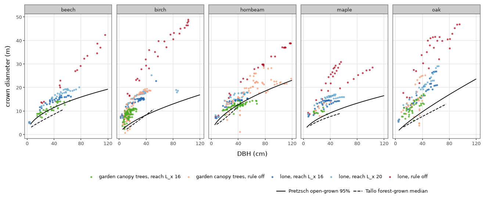
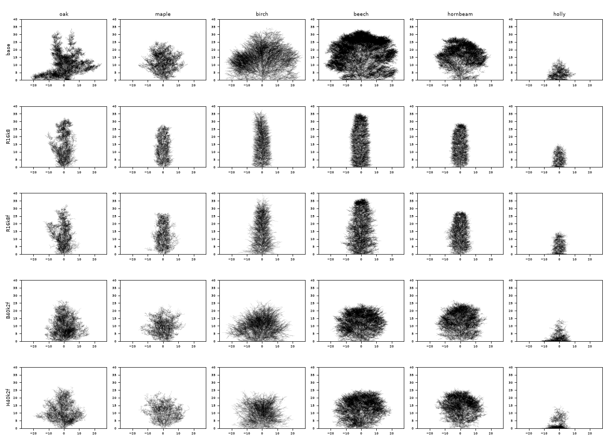

# A size limit on shoot extension: crown width in the garden (2026-11-11)

> **Merged as docs by [#121](https://github.com/epabarker/tree-simulation/issues/121) (2026-11-12). Its rule was not merged.** `c1.pathLimit` lives only on the unmerged branch `probe/121-pathlength`, so its rule-on rounds cannot be re-run at HEAD. Crown extent and girth are now [#129](https://github.com/epabarker/tree-simulation/issues/129)'s. Its §5 question on the canopy definition is answered by [ADR 0065](../decisions/0065-garden-demography-reported-targets.md) (over half the drawn stems' 90th-percentile height). The note is unchanged below this box; its canopy counts use half the tallest tree.

**Exploratory: seeds 1–3, lone trees to season 100, the garden at widths 160 and 66 to season 300.** This is the fourth probe round for [#121](https://github.com/epabarker/tree-simulation/issues/121), on the branch `probe/121-pathlength` (cut from `probe/121-occupancy`, with `research/crown-extent` merged at a4fd3b4). Nothing is adopted:
- the rule is a probe param, off by default and bit-identical;
- no flora, preset, golden or regression changes.

**Question.** The [crown-extent research note](../research/2026-11-11-crown-extent-and-canopy-density.md) ranked first a sink limit on shoot extension that grows with the tree's size, read locally as path length (its section 5, mechanism 1), and asked for a measurement first. Are the simulated crowns too wide at matched stem diameter? If so, does a limit g(L) on extension bring the lone tree into the open-grown envelope and the garden to its bars?

**Answer: partial.**
- **Step 0: yes, the crowns are too wide at matched DBH**, lone and in the stand, and the stems are also far too thick for their age. Both are true; neither is "merely big because the trees are big" (section 1).
- **The form the ticket specified does nothing to width.** g of the path length from the stem base leaves the lone crown as wide as before (2.2–3.6× the open-grown edge), because the leader's tip and a limb's tip are the same path length from the base. Calibrated to measured lateral rates it takes 15–20% off height and lowers the canopy count (section 4).
- **A limit on horizontal reach works on the crown.** `c1.pathLimit: "reach"`, as the chance that a shoot extends:
  - the lone beech and hornbeam sit at 0.8–1.2× Pretzsch's open-grown edge with their height kept;
  - the stand's hornbeam sits at 0.9–1.0×;
  - stem diameter at season 100 falls from 78–196 cm to 42–65 cm;
  - that is with g falling to zero. With the floor the research note's revision asks for (g_min 0.1, Choi's 2–3 cm/yr), the lone beech is back at 1.8–1.9× the edge by season 100 and the hornbeam at 1.3–1.7×.
- **The garden's canopy count rises but does not reach the bar.** Median canopy trees/ha at 160 cells go from 94 to 125–156. The bar is ≥ 120 in every season from 100, and the minimum is 62–94. **No condition passes seeds 1–3 at either width** (12 rule conditions, 2 baselines, 6 runs each), so no 20-seed run and no contact sheet were made.
- **The failure moves.** With narrower crowns the first generation at season 100 is close to the bars (at L_x 16–20: 7–14 canopy trees, and 200–330 drawn stems/ha in seeds 1–2). Then the understorey fills: over 1,000 drawn stems/ha by season 150, and the cap is reached in 119–262 of 300 seasons in every run. That is the schedule (establishment, the bank, the cap), not crown width.
- **Two things step 0 found that change the question** (section 1.4): the garden is planted at 400 stems/ha, not 2,500, and it sits at 0.3–0.85 of Pretzsch & Biber's self-thinning line at its own mean diameter at seasons 25–100. It is under-stocked while it thins.



Each point is one tree at one snapshot (lone: every 10 seasons to 100, seeds 1–3; garden: canopy trees at seasons 25–300, 160 cells, seeds 1–3).

## 1. Step 0: what the trees measure, rule off

**How it was measured.** `dbh.py` reads each metamer snapshot as Level 0 reads a tree (`cli/allometry.ts`):
- **DBH:** twice the pipe-model radius of the trunk cylinder that holds 1.3 m (5.2 cells) of stem length. The trunk is the chain from the root that follows the child with the larger subtree wood volume. Wood only, no bark.
- **Crown diameter:** twice the mean, over ±x and ±z, of the largest offset of a metamer's tip from the trunk at 1.3 m. This is the field's mean crown radius. It reads every metamer, where `allometry.ts` reads those with a live bud, so it is an upper bound.
- **Robust width:** the 5–95% spread of the tips in x (the occupancy note's measure). It is 0.55–0.7 of the crown diameter.
- Coordinates are unwrapped, so a garden crown wider than the 16 m depth period is measured whole.

**Anchors** (`anchors.py`; the research note's section 2.1):
- Pretzsch et al. 2015's open-grown 95% edge, 2·exp(a)·d^α. The field maple is not in the paper, so the sycamore's line stands in. Holly has no anchor.
- Tallo's forest-grown quantiles (`tallo-level0-curves.csv`), inside their support only.
- Hemery et al. 2005's woodland mean.

### 1.1 The lone open-grown tree

`matched.py lone`: where each seed's tree first reaches the DBH, linear between 10-season snapshots. Ranges are the minimum and maximum of seeds 1–3.

| species | DBH (cm) | season reached | height (m) | crown diameter (m) | Pretzsch 95% (m) | sim ÷ Pretzsch | Tallo q50 (q10–q90) (m) | Hemery (m) |
|---|---|---|---|---|---|---|---|---|
| oak | 20 | 19–25 | 12.9–16.0 | 15.0–22.9 | 5.5 | 2.73–4.18 | 4.5 (2.8–6.6) | 4.8 |
| oak | 40 | 33–41 | 21.3–26.7 | 23.8–34.5 | 9.6 | 2.47–3.58 | 7.6 (5.4–10.6) | 8.0 |
| oak | 60 | 47–83 | 28.3–33.2 | 30.8–41.0 | 13.4 | 2.29–3.06 | 10.6 (8.2–14.1) | 11.1 |
| oak | season 100: 66–95 | 100 | 33.0–33.9 | 40.6–46.9 | 14.4–19.6 | 2.37–2.87 | – | – |
| maple | 20 | 12–21 | 8.0–13.2 | 10.0–15.1 | 6.3 (sycamore) | 1.57–2.39 | 5.4 (3.7–6.9) | 4.4 |
| maple | 40 | 20–58 | 12.1–21.6 | 16.3–25.3 | 9.2 (sycamore) | 1.77–2.76 | 7.6 (5.5–9.1) | 8.2 |
| maple | season 100: 48–103 | 100 | 25.4–26.8 | 28.5–30.8 | 10.1–15.2 | 1.87–2.90 | – | – |
| birch | 20 | 23–25 | 16.2–18.7 | 18.6–20.6 | 5.3 | 3.53–3.90 | 4.1 (2.9–6.2) | 4.2 |
| birch | 40 | 37–51 | 22.2–29.4 | 26.6–32.4 | 8.3 | 3.21–3.90 | 8.4 (6.5–10.1) | 7.4 |
| birch | 60 | 52–71 | 25.4–37.0 | 34.0–40.0 | 10.8 | 3.15–3.71 | beyond support | 10.7 |
| birch | season 100: 102–103 | 100 | 30.4–35.3 | 46.4–48.8 | 15.2–15.3 | 3.05–3.20 | – | – |
| beech | 20 | 18–19 | 7.3–8.1 | 12.0–13.2 | 8.3 | 1.44–1.59 | 5.5 (3.7–7.6) | 4.2 |
| beech | 40 | 26–27 | 10.6–11.8 | 17.7–19.9 | 11.5 | 1.54–1.73 | 8.6 (6.4–10.9) | 7.2 |
| beech | 60 | 34–35 | 13.5–15.3 | 23.4–25.1 | 13.9 | 1.68–1.81 | beyond support | 10.3 |
| beech | season 100: 138–196 | 100 | 33.6–36.1 | 50.0–51.7 | 20.6–24.3 | 2.09–2.51 | – | – |
| hornbeam | 20 | 16–17 | 9.4–12.3 | 13.0–13.5 | 8.7 | 1.50–1.56 | 6.8 (5.1–9.4) | – |
| hornbeam | 40 | 25–28 | 14.0–21.2 | 19.9–21.5 | 12.6 | 1.57–1.70 | beyond support | – |
| hornbeam | 60 | 33–38 | 17.7–26.7 | 25.0–26.7 | 15.8 | 1.58–1.69 | beyond support | – |
| hornbeam | season 100: 78–118 | 100 | 29.2–29.3 | 29.8–38.7 | 18.2–22.9 | 1.64–1.69 | – | – |
| holly | 20 | 26–36 | 11.8–12.4 | 14.0–17.8 | – | – | – | – |
| holly | season 100: 23–31 | 100 | 15.3–15.5 | 16.9–21.0 | – | – | – | – |

Maple reaches 60 cm in 1 of 3 seeds (season 35: 20.8 m, 1.82×). Holly never reaches 40 cm.

- **Every lone crown is over the open-grown upper edge at matched DBH:** beech and hornbeam 1.4–1.8×, maple 1.6–2.9×, oak 2.3–4.2×, birch 3.1–3.9×. The edge is the 95% quantile, so a lone tree should sit at or under it.
- **The stems are thick for their age too.** A lone tree reaches 60 cm in 33–83 seasons and stands at 66–196 cm at season 100. Lone W/H is 1.0–1.6; the envelope's W/H (crown rounding §3) is 0.4–1.2.
- **The crown edge moves 3–5× faster than Choi et al. 2001's exposed margins** (`rates.py`; the gain in mean crown radius, cm a season, median of 3 seeds, with the height at the decade's end):

  | species | 10–20 | 20–30 | 30–40 | 40–50 | 50–60 | 60–70 | 70–80 | 80–90 | 90–100 |
  |---|---|---|---|---|---|---|---|---|---|
  | beech | 44 (8 m) | 37 (13 m) | 33 (17 m) | 27 (21 m) | 25 (24 m) | 18 (27 m) | 18 (30 m) | 13 (32 m) | 13 (34 m) |
  | birch | 43 (14 m) | 32 (23 m) | 26 (27 m) | 26 (27 m) | 20 (29 m) | 18 (31 m) | 14 (31 m) | 12 (33 m) | 7 (34 m) |
  | hornbeam | 46 (15 m) | 33 (20 m) | 27 (24 m) | 20 (27 m) | 19 (29 m) | 0 (29 m) | 0 (29 m) | 0 (29 m) | 0 (29 m) |
  | maple | 32 (12 m) | 17 (15 m) | 15 (17 m) | 13 (20 m) | 6 (22 m) | 4 (23 m) | 7 (24 m) | 2 (25 m) | 4 (26 m) |
  | oak | 51 (12 m) | 49 (20 m) | 31 (26 m) | 24 (32 m) | 14 (33 m) | 2 (33 m) | 12 (33 m) | 3 (33 m) | 1 (33 m) |
  | holly | 34 (10 m) | 21 (12 m) | 10 (15 m) | 0 (15 m) | 0 (15 m) | 0 (15 m) | 0 (15 m) | 0 (15 m) | 0 (15 m) |

  Choi's sugar maple: 12 cm/yr at 10 m of height, 4.8 at 20 m, 1.9 at 30 m, levelling at 2–3. The lone beech still gains 13–18 cm a season at 27–34 m. The lone hornbeam, oak and holly stop when their height does (R1's maturity), not before.

### 1.2 The garden's canopy trees (d1 levers, rule off)

`matched.py summary` on `P0-D` (the occupancy note's `O-D0`, re-run with snapshots; its hashes match). Canopy trees are those over half the tallest tree's height. 160 cells, seeds 1–3 pooled.

| species | season | n | DBH (cm) median (range) | height (m) | crown diameter (m) median (range) | robust width x (m) | ÷ Pretzsch 95% median (range) | ÷ Tallo q50 median (n in support) | edge advance (cm/season) |
|---|---|---|---|---|---|---|---|---|---|
| hornbeam | 25 | 9 | 25 (21–32) | 15.8 | 13.5 (10.7–14.4) | 7.3 | 1.31 (1.14–1.60) | 1.57 (9) | – |
| hornbeam | 50 | 8 | 48 (40–69) | 22.5 | 17.8 (15.8–19.7) | 9.5 | 1.25 (1.15–1.35) | – | 10 |
| hornbeam | 75 | 7 | 63 (42–102) | 27.5 | 21.9 (15.4–24.9) | 13.0 | 1.29 (1.02–1.61) | – | 5 |
| hornbeam | 100 | 7 | 65 (43–108) | 28.9 | 21.5 (10.1–26.0) | 13.2 | 1.23 (0.78–1.59) | – | 0 |
| hornbeam | 200 | 6 | 84 (43–119) | 28.8 | 22.8 (1.1–28.4) | 14.5 | 1.12 (0.08–1.56) | – | 2 |
| hornbeam | 300 | 11 | 58 (23–130) | 20.7 | 17.7 (6.2–28.2) | 8.6 | 1.07 (0.65–1.53) | 1.14 (5) | 1 |
| birch | 25 | 24 | 9 (5–17) | 16.3 | 8.8 (4.2–13.6) | 4.6 | 2.59 (1.57–3.54) | 4.29 (11) | – |
| birch | 50 | 16 | 14 (8–22) | 20.3 | 8.7 (0.7–15.8) | 4.5 | 1.99 (0.21–3.12) | 3.08 (12) | 0 |
| birch | 100 | 6 | 25 (12–39) | 28.7 | 14.6 (5.6–18.6) | 9.4 | 2.30 (1.24–2.55) | 2.77 (6) | 1 |
| birch | 300 | 3 | 44 (39–47) | 33.4 | 18.8 (18.6–19.3) | 11.2 | 2.12 (2.04–2.38) | 2.02 (3) | 0 |
| oak | 25 | 7 | 16 (9–19) | 15.5 | 11.7 (9.6–13.3) | 5.6 | 2.58 (2.24–3.40) | 2.91 (6) | – |
| oak | 50 | 6 | 31 (16–34) | 22.6 | 14.9 (8.7–21.3) | 9.2 | 1.97 (1.72–2.83) | 2.41 (6) | 6 |
| oak | 100 | 5 | 36 (24–40) | 23.0 | 11.7 (4.8–24.3) | 11.0 | 1.49 (0.55–2.73) | 1.88 (5) | −3 |
| maple | 25 | 6 | 21 (18–30) | 11.8 | 10.7 (10.1–13.3) | 6.1 | 1.68 (1.62–1.79) | 2.00 (6) | – |
| beech | 300 | 1 | 43 | 20.6 | 13.9 | 8.0 | 1.17 | 1.54 (1) | 1 |

Rowan, willow and holly have no Pretzsch line and are left out; `matched.py garden` prints every survivor's series.

- **At season 25, when the canopy starts to thin, every species is over the open-grown edge:** hornbeam 1.3×, maple 1.7×, oak and birch 2.6×. Against the forest-grown median they are 1.6–4.3×, and hornbeam's 13.5 m is above Tallo's 90% quantile at its DBH (10–12 m).
- **The dominant hornbeams stay at 1.1–1.3× the open-grown edge** as they grow to 65–130 cm. A stand tree should sit at about 0.55–0.85 of that edge (Hemery's woodland lines against Pretzsch, crown rounding §3).
- **By robust width, the hornbeam is inside the edge** (13–14.5 m against 16–22 m at season 100–200). Robust width is not what the field measures, so the crown-diameter column is the comparison.
- **The answer to "too wide at matched DBH, or merely big?" is both.**
  - Too wide at matched DBH: 1.1–1.3× the open-grown edge for the hornbeam that dominates, 1.5–2.6× for the other species.
  - Big because the stem is big: the surviving hornbeams are 43–108 cm at season 100 and 29 m tall. Lockow's hornbeam table has a mean DBH of 26–36 cm at 100 years and a top height of 26–32 m. So the height is right for the age, and the stem and crown are both 2–3× too large for it.
  - The two are one fault in this core: girth follows the pipe model, so a crown that carries too many shoots makes its own stem thick. Matching on DBH therefore hides most of the excess. Matched on height or age, the dominant hornbeam's crown is 21.5 m where a real stand tree's is 8–12 m.

### 1.3 The crown-edge rate in the stand

- **Hornbeam canopy trees:** 10 cm a season over seasons 25–50 (16 → 22 m tall), 5 over 50–75, then 0–2 from season 100.
- **Dominants singly** (`matched.py garden`): 10–15 cm a season to season 75, then −1 to +3.
- **Against the anchors.** The research note's revised rates for canopy-size shade-tolerant trees are 3–7 cm/yr (birch 9–10), and Choi's exposed margin is under 5 cm/yr above 20 m. The stand's 5–15 cm a season at 16–28 m of height is 2–3× that.
- **The crowns do stall from season 100**, which the research note's summary did not expect ("they fail to stop"). They stall because the plot is full (cover 0.94–0.96, the occupancy note §3), after gaining about 4 m of radius in seasons 25–75. So the fault is the rate and the reach before the stall, not the absence of one.

### 1.4 The stand against the self-thinning line

`matched.py thinning`: stems per hectare and their quadratic mean diameter (QMD) at 1.3 m, against Pretzsch & Biber 2005's lines for unthinned, fully stocked stands: ln N = 12.359 − 1.789·ln d (beech) and 10.984 − 1.424·ln d (oak). 160 cells, rule off (`P0-D`).

| run | season | stems ≥ 1.3 m: N/ha, QMD (cm) | line at that QMD: beech, oak (N/ha) | N ÷ line: beech, oak | canopy trees: N/ha, QMD (cm) | line at that QMD: beech, oak | N ÷ line: beech, oak |
|---|---|---|---|---|---|---|---|
| seed 1 | 25 | 438, 17.2 | 1430, 1022 | 0.31, 0.43 | 344, 18.8 | 1221, 901 | 0.28, 0.38 |
| seed 1 | 50 | 375, 25.5 | 710, 585 | 0.53, 0.64 | 219, 31.8 | 478, 427 | 0.46, 0.51 |
| seed 1 | 100 | 125, 44.1 | 267, 269 | 0.47, 0.47 | 94, 50.5 | 209, 221 | 0.45, 0.42 |
| seed 2 | 25 | 484, 16.6 | 1533, 1080 | 0.32, 0.45 | 359, 18.6 | 1250, 918 | 0.29, 0.39 |
| seed 2 | 50 | 359, 28.9 | 569, 491 | 0.63, 0.73 | 250, 33.5 | 436, 397 | 0.57, 0.63 |
| seed 2 | 100 | 156, 54.4 | 183, 199 | 0.85, 0.78 | 125, 60.3 | 152, 172 | 0.82, 0.73 |
| seed 3 | 25 | 953, 12.6 | 2505, 1597 | 0.38, 0.60 | 344, 20.5 | 1045, 796 | 0.33, 0.43 |
| seed 3 | 50 | 562, 20.3 | 1068, 810 | 0.53, 0.69 | 250, 27.5 | 618, 524 | 0.40, 0.48 |
| seed 3 | 100 | 1266, 14.4 | 1980, 1324 | 0.64, 0.96 | 156, 34.3 | 418, 384 | 0.37, 0.41 |

- **The planting is 400 stems/ha** (26 trees on the 0.064 ha plot, `o4.planting`), not the 2,500/ha the research note's section 4 starts from. At season 25 the stand holds 440–950 stems/ha at a QMD of 13–17 cm, where the lines hold 1,000–2,500.
- **The garden is below the line at every stage.** Against the beech line: 0.31–0.38 at season 25, 0.53–0.63 at 50, 0.47–0.85 at 100. Against the oak line it is 0.43–0.96 (seed 3's 0.96 at season 100 is its understorey of thin stems).
- **The canopy trees' QMD is 19–21 cm at season 25 and 34–60 cm at season 100.** The lines reach 34–60 cm at about 140–160 years and beyond their data.
- **What this means.** The canopy thins from 22 trees to 6–10 between seasons 25 and 100 while the stand is at a third to a half of full stocking for its diameter. Real stands at that stocking are not self-thinning. The garden loses canopy trees to overtopping by crowns 1.3–2.6× too wide, and to the O4 draw, not to a density that real stems could not share.

## 2. The rule as built (probe only)

`c1.pathLimit` (absent: `"off"`, bit-identical). In `grow_buds`, after C3 has allocated and the bud has passed its threshold, the shoot's extension is scaled by

g(L) = max(g_min, 1 / (1 + (L / L_x)^k))

with L read at the bud's node as the season began. It is a sink limit in #83's sense: C3 still allocates on light, and what the shoot does not use is not returned (not to R1's reserve either, unlike the turgor probes).

**What L is** (`c1.pathLimit`):
- **`"base"`:** the path length from the stem base. This is R1's L_path and the form the ticket asked for.
- **`"reach"`:** the node's horizontal distance from the stem base.
- **`"height"`:** the tree's height, the same L for every bud. This is the whole-tree size signal the research note's revision offers beside path length.
- **`"trunk"`:** the path length from where the bud's limb left order 0. Kept in the code as the first variant tried; see "What went wrong first" below.

**How g acts** (`c1.pathForm`):
- **`"length"`** (the default): the shoot's internodes are g times as long.
- **`"chance"`:** the shoot extends in full with probability g, else the bud rests this season as a bud below its threshold does (a short shoot if lit, else dormant and ageing toward R4's abort). One draw per live bud and season, from the new RNG purpose `PATH_LIMIT` (21), keyed by the bud's birthId and the season. At g ≥ 1 nothing is drawn.

**Params:** `c1.pathScale` (L_x, cells; absent 60), `c1.pathSteepness` (k; absent 2), `c1.pathFloor` (g_min; absent 0). They are read from the tree's own species params, so a species patch sets them per species; the world's `c1` is the default.

**Why extension and not the bud's sink strength in C3.** Three reasons, all from earlier work:
- #83's resolution rejected allocating on Q·d(L) and kept C3 on light, with the limit acting at the tip.
- `grow_buds` already scales a shoot's internode length twice at that point (R5's elongation, `c1.shootLengthSD`), so the rule is one more factor there and touches nothing in C3's basipetal sums.
- A change to allocation would move resource to other buds of the same tree. The research's evidence is for less extension at large size, not for extension moved elsewhere.

**Why the chance and not the length.** A shoot is one metamer from season ≈ 30 (the turgor-cap note), so scaling the metamer count is a gate. That leaves the internode length or a chance. The length form keeps the leaf and bud count per shoot, so foliage is 1/g times as dense where g is small, and a shade-tolerant crown fills with it (below). The chance keeps leaf per metre of axis as it was.

**No state.** L is one pass over the metamers at the start of `grow_buds` (a local vector); nothing is added to the tree's tables, and the checkpoint layout is unchanged. R1's `path_len` column is not reused, because it is only filled when R1 is on.

**Tests** (in the principle's file, plus the season loop):
- `c1::a_path_scale_is_half_at_l_x_and_falls_as_the_steepness_says`: g worked by hand at k 2 and 4, the floor, and exactly 1 when off;
- `c1::a_path_length_runs_from_the_stem_base_or_from_the_trunk`: L on a five-metamer tree for the four meanings;
- `c1::a_path_chance_extends_a_shoot_with_probability_g`: g 1 and 0, the same answer when asked again, the rate over 20,000 buds;
- `season::a_shoot_far_along_its_path_extends_less`: the seedling's shoot is half as long at L = L_x from the base and full length from the trunk;
- `season::a_bud_the_path_chance_bars_rests_and_keeps_its_internode_length`.
- **How they were written.** The first two slices (the length form with base and trunk; then reach and the chance) were red before green. The third (the floor and the height signal) was added with its assertions in one step, so its red state was not observed. The seams (`path_scale`, `path_lengths`, `path_extends`, `grow_buds`) were chosen by me and not agreed beforehand.

**Bit-identity, rule off:**
- `cargo test -p tree-core --release --test golden`: 2 of 2 pass at each stage of the rule.
- The rule-off garden runs reproduce the earlier notes' hashes: `P0-D` 160 seed 1 is ff6f2156 (the occupancy note's `O-D0`).

**What went wrong first** (round 1; kept as evidence):
- **"Trunk" is not the stem.** Order 0 ends at 6–11 m in the lone beech, hornbeam and maple, whose leader is a chain of relays and has order 40–56 at the top (oak 3, birch 7). So "from where the limb left order 0" counts most of the stem's own height as reach. The lone beech stopped at 16 m (36 m at HEAD). The research note's revision also withdraws this variant for want of evidence.
- **The length form floods a shade-tolerant crown with metamers.** Lone beech, `trunk` L_x 12, k 4, length form: 907,000 metamers at season 100 (247,000 at HEAD), DBH 215 cm, 2.7 GB of memory. One maple seed reached 398,000 and 152 cm. The run was stopped there (10 of 18 lone runs done). Its garden condition (`P1-D-T12k4`) is in the table for completeness. It is the only condition that holds ≥ 120 canopy trees/ha in 3 of 3 runs, and it does so with beech at 49–84% of stems and these stems.

## 3. The lone open-grown guard, rule on

`lone_table.py`, season 100, the minimum and maximum of seeds 1–3. "At DBH 40" is where the tree first reaches 40 cm. Features are the core's own columns: round in plan (min ÷ max of crown width and depth; ≥ 0.75 wanted), box held (`budsOutside` 0 in every season), top-fifth leaf (0.15–0.30 wanted for a rounded crown), w90 (the top's width over the widest; near 1 is a flat cap).

| condition | species | height (m) | DBH (cm) | crown diameter (m) | ÷ Pretzsch 95% | at DBH 40: season, height (m), crown (m), ÷ Pretzsch | W/H | round | box held | top-fifth leaf | w90 | metamers (k) |
|---|---|---|---|---|---|---|---|---|---|---|---|---|
| rule off | oak | 33.0–33.9 | 66–95 | 40.6–46.9 | 2.37–2.87 | 33–41, 21.3–26.7, 23.8–34.5, 2.47–3.58 | 1.20–1.42 | 0.72–0.93 | 3 of 3 | 0.03–0.05 | 0.16–0.49 | 83–91 |
| rule off | maple | 25.4–26.8 | 48–103 | 28.5–30.8 | 1.87–2.90 | 20–58, 12.1–21.6, 16.3–25.3, 1.77–2.76 | 1.09–1.17 | 0.90–0.95 | 3 of 3 | 0.03–0.11 | 0.17–0.57 | 46–47 |
| rule off | birch | 30.4–35.3 | 102–103 | 46.4–48.8 | 3.05–3.20 | 37–51, 22.2–29.4, 26.6–32.4, 3.21–3.90 | 1.31–1.61 | 0.86–1.00 | 2 of 3 | 0.02–0.03 | 0.31–0.44 | 111–126 |
| rule off | beech | 33.6–36.1 | 138–196 | 50.0–51.7 | 2.09–2.51 | 26–27, 10.6–11.8, 17.7–19.9, 1.54–1.73 | 1.43–1.49 | 0.89–0.99 | 3 of 3 | 0.14–0.17 | 0.39–0.45 | 247–264 |
| rule off | hornbeam | 29.2–29.3 | 78–118 | 29.8–38.7 | 1.64–1.69 | 25–28, 14.0–21.2, 19.9–21.5, 1.57–1.70 | 1.02–1.32 | 0.88–0.98 | 3 of 3 | 0.06–0.15 | 0.28–0.50 | 70–110 |
| rule off | holly | 15.3–15.5 | 23–31 | 16.9–21.0 | – | not reached | 1.09–1.37 | 0.88–0.96 | 3 of 3 | 0.01 | 0.13–0.19 | 12–19 |
| reach 12, k 8 | oak | 32.6–33.2 | 50–65 | 17.9–18.6 | 1.26–1.60 | 44–54, 26.9–28.7, 13.3–14.2, 1.38–1.47 | 0.54–0.56 | 0.84–0.95 | 3 of 3 | 0.07–0.11 | 0.27–0.82 | 24–27 |
| reach 12, k 8 | maple | 29.0–31.3 | 39–41 | 11.6–12.2 | 1.28–1.31 | 95, 28.4, 12.3, 1.33 (1 of 3) | 0.38–0.42 | 0.94–0.99 | 3 of 3 | 0.11–0.15 | 0.57–0.75 | 19–20 |
| reach 12, k 8 | birch | 32.7–37.8 | 30 | 12.2–13.2 | 1.78–1.91 | not reached | 0.35–0.37 | 0.95–0.98 | 3 of 3 | 0.03–0.08 | 0.56–0.80 | 26–29 |
| reach 12, k 8 | beech | 33.5–35.0 | 42–48 | 13.3–14.5 | 1.12–1.15 | 49–93, 19.3–32.2, 12.2–13.1, 1.06–1.14 | 0.38–0.42 | 0.87–0.93 | 3 of 3 | 0.16–0.18 | 0.72–0.74 | 40–42 |
| reach 12, k 8 | hornbeam | 28.9–29.8 | 42–59 | 12.5–12.9 | 0.80–1.00 | 48–75, 24.5–29.0, 11.8–12.9, 0.93–1.02 | 0.42–0.44 | 0.90–0.98 | 3 of 3 | 0.16–0.19 | 0.71–0.78 | 28 |
| reach 12, k 8 | holly | 15.1–15.4 | 16–18 | 9.2–10.9 | – | not reached | 0.60–0.71 | 0.87–0.98 | 3 of 3 | 0.02–0.04 | 0.26–0.37 | 6–9 |
| reach 16, k 8 | oak | 32.7–33.0 | 53–62 | 21.0–26.8 | 1.52–1.98 | 48–51, 25.3–29.8, 16.1–19.7, 1.67–2.04 | 0.64–0.82 | 0.89–0.96 | 3 of 3 | 0.04–0.14 | 0.32–0.57 | 33–36 |
| reach 16, k 8 | maple | 28.4–30.8 | 38–53 | 14.2–14.6 | 1.33–1.64 | 44–94, 18.7–27.2, 12.9–14.4, 1.41–1.57 (2 of 3) | 0.47–0.51 | 0.90–1.00 | 3 of 3 | 0.11–0.13 | 0.66–0.68 | 23–25 |
| reach 16, k 8 | birch | 37.8–41.6 | 36–55 | 14.9–22.7 | 1.89–2.24 | 92, 42.1, 17.1, 2.06 (1 of 3) | 0.36–0.55 | 0.76–0.99 | 3 of 3 | 0.05–0.08 | 0.59–0.71 | 37–44 |
| reach 16, k 8 | beech | 35.9–39.3 | 56–65 | 15.9–16.5 | 1.11–1.18 | 45–63, 20.3–25.3, 13.9–15.5, 1.21–1.35 | 0.41–0.46 | 0.92–0.99 | 3 of 3 | 0.15–0.17 | 0.67–0.71 | 56–58 |
| reach 16, k 8 | hornbeam | 29.4–29.5 | 43–54 | 14.5–15.2 | 1.02–1.11 | 50–63, 26.9–28.8, 14.5–15.1, 1.14–1.20 | 0.49–0.52 | 0.94–0.99 | 3 of 3 | 0.16–0.17 | 0.62–0.75 | 33–37 |
| reach 16, k 8 | holly | 15.5–15.9 | 16–23 | 11.1–12.1 | – | not reached | 0.70–0.77 | 0.93–0.99 | 3 of 3 | 0.02–0.04 | 0.18–0.62 | 8–13 |
| reach 20, k 8 | oak | 33.1–33.5 | 46–64 | 21.4–29.0 | 1.78–2.05 | 44–71, 29.0–33.1, 19.0–20.7, 1.97–2.15 | 0.65–0.88 | 0.92–0.94 | 3 of 3 | 0.02–0.05 | 0.17–0.30 | 37–38 |
| reach 20, k 8 | maple | 29.4–31.6 | 47–60 | 15.9–17.1 | 1.39–1.69 | 29–70, 15.1–26.3, 13.6–16.4, 1.48–1.78 | 0.51–0.58 | 0.95–0.98 | 3 of 3 | 0.07–0.15 | 0.49–0.87 | 27–30 |
| reach 20, k 8 | birch | 36.5–53.1 | 39–87 | 18.2–18.6 | 1.35–2.24 | 63–93, 35.4–41.1, 17.9–19.6, 2.15–2.37 (2 of 3) | 0.35–0.50 | 0.85–0.98 | 2 of 3 | 0.05–0.11 | 0.65–0.76 | 46–55 |
| reach 20, k 8 | beech | 33.4–37.7 | 60–78 | 18.9–20.1 | 1.28–1.39 | 32–37, 13.4–16.3, 15.6–16.3, 1.35–1.41 | 0.52–0.60 | 0.92–0.99 | 3 of 3 | 0.18–0.20 | 0.74–0.75 | 68–73 |
| reach 20, k 8 | hornbeam | 28.9–29.3 | 47–54 | 17.0–17.8 | 1.20–1.29 | 35–49, 18.7–26.3, 15.4–17.5, 1.22–1.39 | 0.58–0.61 | 0.95–1.00 | 3 of 3 | 0.16–0.19 | 0.69–0.75 | 40–48 |
| reach 20, k 8 | holly | 15.1–15.7 | 18–25 | 12.9–14.6 | – | not reached | 0.86–0.93 | 0.92–0.94 | 3 of 3 | 0.01–0.02 | 0.31–0.45 | 9–14 |
| base 120, k 4 | oak | 31.1–32.9 | 83–93 | 40.0–48.4 | 2.28–2.53 | 29–44, 17.7–24.9, 24.1–31.5, 2.50–3.27 | 1.22–1.56 | 0.88–0.99 | 3 of 3 | 0.01–0.03 | 0.12–0.48 | 75–100 |
| base 120, k 4 | maple | 23.1–25.9 | 69–86 | 29.1–35.1 | 2.10–2.86 | 21–48, 11.6–18.7, 14.9–25.7, 1.62–2.80 | 1.25–1.52 | 0.87–1.00 | 3 of 3 | 0.05–0.16 | 0.51–0.68 | 42–50 |
| base 120, k 4 | birch | 32.0–44.2 | 96–100 | 43.7–52.9 | 2.97–3.63 | 38–41, 22.0–26.4, 27.1–30.3, 3.27–3.66 | 1.20–1.53 | 0.91–1.00 | 3 of 3 | 0.01–0.02 | 0.24–0.36 | 101–121 |
| base 120, k 4 | beech | 31.1–34.0 | 127–172 | 48.3–52.4 | 2.15–2.44 | 26–27, 10.1–13.7, 18.4–18.7, 1.60–1.63 | 1.42–1.68 | 0.94–0.99 | 3 of 3 | 0.10–0.13 | 0.47–0.48 | 187–206 |
| base 120, k 4 | hornbeam | 28.9–29.1 | 73–112 | 31.2–39.0 | 1.73–1.80 | 27–38, 19.0–19.3, 19.8–26.9, 1.56–2.12 | 1.07–1.35 | 0.92–0.99 | 3 of 3 | 0.04–0.14 | 0.18–0.44 | 75–107 |
| base 120, k 4 | holly | 15.1–15.2 | 18–36 | 14.7–22.3 | – | not reached | 0.97–1.47 | 0.91–0.98 | 3 of 3 | 0.01–0.03 | 0.23–0.40 | 10–24 |
| reach 16, k 8, floor 0.1 | oak | 32.7–32.8 | 61–62 | 20.5–36.7 | 1.48–2.69 | 43–56, 25.8–30.1, 15.9–26.3, 1.65–2.72 | 0.62–1.12 | 0.69–0.97 | 3 of 3 | 0.05–0.14 | 0.37–0.46 | 33–45 |
| reach 16, k 8, floor 0.1 | maple | 27.3–30.1 | 40–55 | 18.5–23.1 | 1.71–2.53 | 49–84, 18.6–28.8, 15.6–17.8, 1.70–1.94 (2 of 3) | 0.61–0.85 | 0.96–0.98 | 3 of 3 | 0.13–0.15 | 0.41–0.46 | 25–27 |
| reach 16, k 8, floor 0.1 | birch | 39.8–50.6 | 37–79 | 25.9–27.2 | 2.06–3.45 | 71–96, 41.9–42.7, 22.9–25.4, 2.76–3.06 (2 of 3) | 0.53–0.68 | 0.87–0.96 | 2 of 3 | 0.02–0.04 | 0.51–0.55 | 40–47 |
| reach 16, k 8, floor 0.1 | beech | 37.0–39.6 | 57–67 | 25.4–27.6 | 1.84–1.89 | 41–56, 18.7–23.1, 17.1–19.5, 1.49–1.70 | 0.64–0.74 | 0.89–0.99 | 3 of 3 | 0.10–0.15 | 0.39–0.50 | 73–75 |
| reach 16, k 8, floor 0.1 | hornbeam | 28.9–29.5 | 39–47 | 16.7–20.7 | 1.27–1.66 | 44–52, 27.2–27.9, 16.4–19.2, 1.30–1.52 (2 of 3) | 0.57–0.71 | 0.89–0.96 | 3 of 3 | 0.05–0.18 | 0.42–0.60 | 30–42 |
| reach 16, k 8, floor 0.1 | holly | 15.3–15.4 | 17–22 | 10.6–15.0 | – | not reached | 0.69–0.97 | 0.87–0.97 | 3 of 3 | 0.02–0.04 | 0.22–0.57 | 7–13 |
| base 40, k 2, floor 0.1 | oak | 23.1–27.2 | 53–75 | 30.9–33.7 | 2.09–2.78 | 38–58, 16.7–22.3, 23.7–26.3, 2.46–2.72 | 1.14–1.46 | 0.72–0.94 | 3 of 3 | 0.02–0.08 | 0.19–0.55 | 46–53 |
| base 40, k 2, floor 0.1 | maple | 21.8–24.3 | 58–76 | 27.1–27.7 | 2.11–2.41 | 25–34, 12.1–15.1, 16.8–19.2, 1.83–2.09 | 1.14–1.25 | 0.78–0.99 | 3 of 3 | 0.02–0.05 | 0.30–0.52 | 29–32 |
| base 40, k 2, floor 0.1 | birch | 25.0–28.1 | 37–98 | 41.0–45.7 | 2.78–5.41 | 44–51, 18.1–20.5, 27.3–31.7, 3.29–3.82 (2 of 3) | 1.46–1.71 | 0.92–0.96 | 3 of 3 | 0.00–0.02 | 0.09–0.57 | 69–78 |
| base 40, k 2, floor 0.1 | beech | 24.5–25.5 | 94–138 | 38.7–40.6 | 1.97–2.24 | 30–35, 11.1–12.9, 19.3–21.5, 1.68–1.87 | 1.58–1.60 | 0.93–0.96 | 3 of 3 | 0.08–0.12 | 0.48–0.70 | 108–116 |
| base 40, k 2, floor 0.1 | hornbeam | 24.1–27.0 | 83–93 | 34.6–37.5 | 1.72–1.99 | 34–38, 14.7–17.8, 21.2–22.8, 1.68–1.80 | 1.28–1.52 | 0.82–0.97 | 3 of 3 | 0.08–0.13 | 0.49–0.65 | 82–84 |
| base 40, k 2, floor 0.1 | holly | 15.2–15.3 | 18–33 | 18.7–20.9 | – | not reached | 1.22–1.38 | 0.89–0.97 | 3 of 3 | 0.01 | 0.21–0.38 | 14–16 |
| height 40, k 2, floor 0.1 | oak | 25.0–28.0 | 51–70 | 29.5–32.7 | 2.15–2.78 | 40–77, 18.4–23.5, 24.4–29.1, 2.53–3.02 | 1.17–1.23 | 0.76–0.84 | 3 of 3 | 0.02–0.05 | 0.18–0.65 | 37–41 |
| height 40, k 2, floor 0.1 | maple | 24.5–25.0 | 65–71 | 26.4–31.1 | 2.16–2.50 | 32–47, 13.7–19.2, 19.7–22.0, 2.14–2.40 | 1.07–1.27 | 0.86–0.92 | 3 of 3 | 0.03–0.07 | 0.63–0.80 | 23–27 |
| height 40, k 2, floor 0.1 | birch | 24.9–28.5 | 60–83 | 37.0–44.5 | 3.03–3.63 | 41–55, 16.3–21.5, 27.9–29.8, 3.36–3.60 | 1.32–1.57 | 0.88–0.93 | 3 of 3 | 0.00–0.03 | 0.46–0.66 | 51–67 |
| height 40, k 2, floor 0.1 | beech | 26.0–27.5 | 77–143 | 40.1–40.4 | 1.92–2.58 | 34–51, 13.3–19.1, 21.3–29.4, 1.85–2.56 | 1.46–1.55 | 0.97–0.99 | 3 of 3 | 0.07–0.10 | 0.45–0.58 | 106–115 |
| height 40, k 2, floor 0.1 | hornbeam | 26.6–29.1 | 80–95 | 32.7–37.5 | 1.61–1.95 | 29–39, 15.2–16.8, 18.5–23.0, 1.46–1.82 | 1.19–1.41 | 0.87–0.97 | 3 of 3 | 0.06–0.10 | 0.39–0.61 | 76–81 |
| height 40, k 2, floor 0.1 | holly | 15.1–15.8 | 17–18 | 16.0–21.7 | – | not reached | 1.01–1.43 | 0.79–0.89 | 3 of 3 | 0.00–0.01 | 0.06–0.59 | 9–14 |

All rule conditions in this table are the chance form. The live crown base is 0.00–0.03 in every row, as at HEAD: the rule does not move the bare bole on a lone tree.

**Reading the table:**
- **Reach brings beech and hornbeam to the open-grown edge** (0.8–1.2× at L_x 12–16, 1.2–1.4× at 20) **and keeps their height** (29–39 m against 29–36 m). Maple gains 3–5 m of height.
- **Oak and birch stay over the edge** (1.3–2.2×) at every L_x, and get further over it as L_x rises, because their stems thin with the crown: the lone birch is 30 cm at 33–38 m tall under reach 12.
  - Their crowns are also wider than the limit allows a shoot to grow to (oak 21–29 m at L_x 16–20, where g is under 0.01 beyond 8–9 m of reach). The likely cause is R3's sag carrying existing limbs outward after they grew; I did not test it.
- **Birch's leader runs away:** 37–53 m at L_x 16–20 against 30–35 m at HEAD. One seed leaves the 50 m box at L_x 20 (one does at HEAD too, by its crown). Resource the limbs cannot use goes up.
- **The crown becomes a column.** W/H falls from 1.0–1.6 to 0.35–0.6 for beech, hornbeam and maple; the envelope's own W/H is 0.5–0.7 for those three, so that is the right side of the error. But w90 rises from 0.3–0.5 to 0.6–0.8: the top is nearly as wide as the widest slice. A reach limit that is the same at every height makes a cylinder, which works against the rounded-crown feature's outline.
- **Top-fifth leaf rises into the wanted band for hornbeam** (0.06–0.15 → 0.16–0.19) and stays in it for beech. Oak and birch stay under it.
- **Stem diameter at season 100 falls to 42–78 cm** for beech and hornbeam (78–196 cm at HEAD), and the metamer count falls by a factor of 2–6.
- **The base form changes nothing on the lone tree** at L_x 120: crowns 2.2–3.6× the edge, as at HEAD.
- **The floor undoes much of the reach limit by season 100.** With g_min 0.1 (2.5 cm a season of creep, Choi's level) the lone beech is 25–28 m wide (1.8–1.9× the edge) against 16 m without it, and the hornbeam 17–21 m (1.3–1.7×) against 15 m. The creep adds 2.5 m of radius over 100 seasons by itself, and each extension lays a full-length metamer with new lateral buds beyond the limit.
- **Path length and tree height, at Choi's rates, shrink the tree and keep its shape:** height 23–29 m against 29–36 m, crowns still 1.6–5.4× the edge, W/H 1.1–1.7 as at HEAD.



Rows: rule off; reach 16, k 8; the same with the floor; path from the base and tree height at Choi's rates. Axes in metres. **Looked at:** under reach every species is a column of the same width from the ground to the top, the lone beech and hornbeam included. That is not the open-grown form of any of them, whatever the width against DBH says. The floor softens the column into a cone. The path and height forms give a smaller tree of the same shape as HEAD's.

## 4. The garden, rule on

- **Setup:** `sweep.ts` (the garden schedule's runner), `forestParams(width, seed)`, seasons 300, seeds 1–3 × widths 160 and 66, metamer snapshots at 25/50/75/100/150/200/300.
- **"d1 levers" (D):** `o4.suppressionSignal: "topLight"`, `topLightThreshold` 0.15, hornbeam `o4.cSeed` 300. **N** is without them.
- **Simulators:** 6 at a time at most.
- **Bars** (`score.py`, every count from the core's `stand.csv` and `stand-species.csv`):
  - **160 cells:** ≥ 120 canopy trees/ha in every season from 100 (8 trees on the plot); drawn stems 200–400/ha at seasons 100/200/300; ≥ 60% of drawn stems in the canopy; no species above 70%; a canopy tree in every season after 50; the cap never reached.
  - **66 cells, as amended on 2026-11-11:** ≥ 1 canopy tree in every season from 100; no gap; the cap never reached; no species above 70% at 100/200/300.
- **Names:** R = reach, B = base, H = height, T = trunk; then L_x in cells and k; `f` = floor g_min 0.1. All are the chance form except T12k4.

| condition | 160: canopy ≥ 120/ha from 100 (runs of 3) | band / canopy share / mix (frames of 9) | no gap, cap-free (runs of 3) | 160 runs passing | canopy/ha 160: median, minimum from 100 | 66: ≥ 1 canopy from 100, no gap, cap-free (runs of 3) | 66 mix (frames of 9) | 66 runs passing | canopy trees at 100, 160: median DBH (cm) / height (m) / crown diameter (m) | hornbeam share 160 / 66 |
|---|---|---|---|---|---|---|---|---|---|---|
| N, rule off | 0 | 2 / 1 / 3 | 3, 0 | 0 of 3 | 94, 62 | 3, 3, 0 | 4 | 0 of 3 | 37 / 25.3 / 9.9 | 0.81 / 0.75 |
| D, rule off | 0 | 0 / 3 / 5 | 3, 1 | 0 of 3 | 94, 47 | 3, 3, 0 | 6 | 0 of 3 | 39 / 24.4 / 12.2 | 0.63 / 0.60 |
| D R12k8 | 0 | 0 / 0 / 7 | 3, 0 | 0 of 3 | **156**, 94 | 3, 3, 0 | 6 | 0 of 3 | 24 / 25.1 / 9.9 | 0.11 / 0.20 |
| **D R16k8** | 0 | 2 / 1 / **9** | 3, 0 | 0 of 3 | 141, 62 | 3, 3, 0 | 5 | 0 of 3 | 24 / 26.8 / 10.7 | 0.40 / 0.56 |
| D R20k8 | 0 | 3 / 1 / 8 | 3, 0 | 0 of 3 | 141, 78 | 3, 3, 0 | 5 | 0 of 3 | 32 / 27.5 / 12.1 | 0.38 / 0.42 |
| D R24k8 | 0 | 1 / 2 / 7 | 3, 0 | 0 of 3 | 94, 62 | 3, 3, 0 | 5 | 0 of 3 | 29 / 27.2 / 13.7 | 0.48 / 0.70 |
| D R16k4 | 0 | 2 / 2 / 8 | 3, 0 | 0 of 3 | 109, 62 | 3, 3, 0 | 6 | 0 of 3 | 28 / 25.7 / 12.2 | 0.30 / 0.64 |
| D R16k8f | 0 | 2 / 1 / 9 | 3, 0 | 0 of 3 | 125, 78 | 3, 3, 0 | 6 | 0 of 3 | 35 / 28.8 / 11.6 | 0.42 / 0.32 |
| N R16k8 | 0 | 2 / 0 / 8 | 3, 0 | 0 of 3 | 94, 62 | 3, 3, 0 | 3 | 0 of 3 | 25 / 26.6 / 11.2 | 0.47 / 0.84 |
| N R20k8 | 0 | 2 / 0 / 8 | 3, 0 | 0 of 3 | 141, 62 | 3, 3, 0 | 3 | 0 of 3 | 41 / 28.9 / 12.8 | 0.50 / 0.85 |
| D B120k4 | 0 | 3 / 4 / 6 | 3, 1 | 0 of 3 | 62, 47 | 3, 3, 0 | 4 | 0 of 3 | 33 / 23.0 / 12.8 | 0.67 / 1.00 |
| D B40k2f | 0 | 4 / 6 / 6 | 3, 1 | 0 of 3 | 78, 47 | 3, 3, 2 | 4 | 0 of 3 | 29 / 18.1 / 11.3 | 0.23 / 0.33 |
| D H40k2f | 0 | 1 / 3 / 5 | 3, 1 | 0 of 3 | 47, 47 | 3, 3, 0 | 4 | 0 of 3 | 40 / 18.9 / 12.7 | 0.23 / 0.50 |
| D T12k4 (length form; see section 2) | 3 | 0 / 0 / 6 | 3, 0 | 0 of 3 | 234, 156 | 3, 3, 0 | 6 | 0 of 3 | 30 / 23.6 / 8.0 | 0.04 / 0.02 |

One tree is 15.6/ha at 160 cells. The "canopy trees at 100" column is the median over all canopy trees, the subordinate ones included.

**Reading the table:**
- **Reach raises the median canopy count by a half** with the d1 levers: 94 → 125–156/ha at L_x 12–20, and back to 94 at L_x 24. The count is quantised (3 seeds, one tree is 15.6/ha), so the order within 125–156 means little.
- **No reach condition holds ≥ 120/ha in every season from 100.** The minimum is 62–94/ha (4–6 trees).
- **The phone width holds ≥ 1 canopy tree from season 100 in every run of every condition,** the baselines included, and has no gap. It fails on the cap in every run but two (B40k2f), and on the mix.
- **The cap is reached in every reach run at both widths** (119–262 of 300 seasons at 160). At baseline with the d1 levers it is reached in 2 of 3 runs at 160.
- **Hornbeam's share falls** from 0.63 to 0.11–0.48 at 160 cells, and beech and maple rise. Mix passes 9 of 9 frames at R16k8.
- **Without the d1 levers** reach gives 94–141/ha, and the phone width's mix fails (hornbeam 0.84).
- **The floor** (g_min 0.1, about 2.5 cm a season of creep) costs one tree at the median (141 → 125/ha) and widens the canopy crowns by 0.9 m. On the lone tree it costs much more (section 3).
- **The base form and the height signal lower the count** (62–78 and 47/ha) and leave the canopy crowns as wide as at baseline (11.3–12.8 m). Calibrated to Choi's rates they make the stand 18–19 m tall at season 100, against 24–25 m.

**The closest condition per run** (`P2-D-R16k8`, 160 cells: drawn stems (per ha), canopy trees, the top species, at each frame):

| seed | 100 | 200 | 300 | canopy trees at 25 / 50, min from 100 | seasons at cap |
|---|---|---|---|---|---|
| 1 | 19 (297), 8, beech 16% | 94 (1469), 4, beech 61% | 67 (1047), 6, beech 51% | 24 / 15, 4 | 194 |
| 2 | 21 (328), 14, birch 24% | 107 (1672), 13, hornbeam 44% | 45 (703), 10, hornbeam 47% | 23 / 22, 7 | 257 |
| 3 | 83 (1297), 11, maple 37% | 111 (1734), 7, hornbeam 53% | 35 (547), 9, hornbeam 40% | 21 / 18, 4 | 231 |

At 66 cells the same condition holds 2, 4 and 1 canopy trees at the minimum from season 100, with 303–1,780 drawn stems/ha and the cap reached in 187–219 seasons.

**The stand's crowns with the rule** (`matched.py summary`, `P2-D-R16k8`, hornbeam canopy trees):

| season | n | DBH (cm) median (range) | height (m) | crown diameter (m) median (range) | ÷ Pretzsch 95% | edge advance (cm/season) |
|---|---|---|---|---|---|---|
| 25 | 9 | 22 (17–26) | 16.5 | 10.6 (10.1–11.6) | 1.17 (1.11–1.29) | – |
| 50 | 9 | 32 (30–39) | 23.9 | 12.4 (10.8–13.3) | 1.10 (1.00–1.14) | 3 |
| 100 | 8 | 43 (37–51) | 28.8 | 12.7 (11.1–14.2) | 0.97 (0.91–1.08) | 0 |
| 200 | 7 | 47 (43–67) | 28.8 | 13.0 (12.2–14.2) | 0.91 (0.85–0.95) | 0 |

- The hornbeam's stem at season 100 is 43 cm (65 cm at HEAD) and its crown 12.7 m (21.5 m). Lockow's table has 26–36 cm at 100 years.
- The edge rate from season 25 is 3 cm a season, then 0: inside the research note's 3–7 cm/yr.
- Birch and oak canopy trees stay at 1.5–2.6× the edge (8.5–13 m crowns on 17–33 cm stems).

## 5. Why the bars still fail

- **The first generation is close.** At season 100 the reach conditions hold 7–16 canopy trees at 160 cells (R16k8: 8, 14, 11; baseline D: 6, 8, 10), and at L_x 16–20 the drawn stems of seeds 1–2 are inside the band (200–330/ha).
- **Then the understorey arrives.** `stand.csv` every 25 seasons, canopy / drawn / live, 160 cells:

  | condition, seed | 75 | 100 | 125 | 150 | 200 | 250 | 300 |
  |---|---|---|---|---|---|---|---|
  | D rule off, 1 | 8/12/12 | 6/8/44 | 5/5/98 | 5/6/137 | 3/12/87 | 2/5/54 | 2/3/88 |
  | D rule off, 2 | 9/13/24 | 8/10/107 | 7/8/158 | 6/8/141 | 3/138/160 | 3/80/140 | 8/46/97 |
  | D rule off, 3 | 12/29/160 | 10/81/160 | 10/89/160 | 9/83/160 | 8/67/160 | 7/103/160 | 9/38/153 |
  | D R16k8, 1 | 9/21/82 | 8/19/121 | 7/30/160 | 5/71/160 | 4/94/160 | 5/87/160 | 6/67/160 |
  | D R16k8, 2 | 13/22/160 | 14/21/160 | 10/81/160 | 10/100/160 | 13/107/160 | 17/57/160 | 10/45/160 |
  | D R16k8, 3 | 14/31/160 | 11/83/160 | 10/82/160 | 9/84/160 | 7/111/160 | 20/60/160 | 9/35/160 |

  With the rule the live count is at the cap (160) by season 50–125 in every seed, and drawn stems pass 1,000/ha by season 150. Narrow crowns let more light to the ground, so more seedlings establish and more of them grow past 1.3 m.
- **The canopy still loses trees after season 100** (14 → 10, 8 → 4). The planted cohort's fate (`occupancy.py --runs`; 78 planted trees over 3 seeds at 160 cells):

  | condition | O4 draw, below canopy | O4 draw, canopy | R1 starved | R3 thrown | alive at 300 |
  |---|---|---|---|---|---|
  | D, rule off | 26 | 23 | 8 | 6 | 15 |
  | D R16k8 | 22 | 18 | 5 | 14 | 19 |
  | D R20k8 | 27 | 18 | 8 | 14 | 11 |

  Fewer canopy trees die by the O4 draw, and twice as many are thrown (R3). A thinner stem under the same crown height is the likely reason; I did not test it.
- **The canopy count's definition moves with one tree.** "Canopy" is over half the top height, and with the rule single trees reach 37–45 m (a birch or beech leader) for a few decades, which raises the threshold to 19–22 m and drops others out of the class. Seed 2 of R12k8 has a 44 m top at season 300.
- **Against the self-thinning line the stand is emptier, not fuller.** With reach 16 the canopy trees' QMD at season 100 is 29–36 cm (34–60 cm at HEAD), where the lines hold 390–580/ha. The garden holds 125–219: 0.30–0.38 of the beech line, against 0.37–0.82 at HEAD. The space the narrower crowns free is taken by recruits from below, not by more canopy trees, because only 26 trees were planted.

## 6. Which variable fits: path length, reach or tree height

The research note's revision says path length is defensible only as a local stand-in for tree size, withdraws the from-the-trunk variant, asks for a floor, and offers a whole-tree height or girth signal as equally supported. Round 4 ran the three side by side with a floor of 0.1, the path and height forms calibrated to Choi's exposed-margin rates (0.48, 0.19 and 0.08 cells a season at 10, 20 and 30 m: L_x 40, k 2).

| | path from the base (B40k2f) | tree height (H40k2f) | reach (R16k8f) |
|---|---|---|---|
| Lone crown at season 100 ÷ Pretzsch: beech, hornbeam (HEAD 2.1–2.5, 1.6–1.7) | 2.0–2.2, 1.7–2.0 | 1.9–2.6, 1.6–2.0 | 1.8–1.9, 1.3–1.7 (no floor: 1.1–1.2, 1.0–1.1) |
| Lone height at season 100 (m): beech, hornbeam, oak (HEAD 34–36, 29, 33–34) | 25, 24–27, 23–27 | 26–28, 27–29, 25–28 | 37–40, 29–30, 33 |
| Garden canopy/ha, median (D rule off: 94) | 78 | 47 | 125 |
| Garden canopy trees at 100: height, crown (m) | 18.1, 11.3 | 18.9, 12.7 | 28.8, 11.6 |
| Garden bars passed | 0 of 6 runs | 0 of 6 runs | 0 of 6 runs |

- **Neither size signal narrows a crown relative to its height.** Both slow the leader exactly as they slow a limb, so the tree is a smaller copy of itself: the stand is 18–19 m tall at season 100 where the hornbeam table has 26–32 m, and its canopy crowns are as wide as before.
- **Of the two, path length does slightly better than height** in the garden (78 against 47 canopy trees/ha; the cap never reached in 2 of 3 phone runs). On three seeds that is one or two trees.
- **Reach is the only variable tried that changes crown width at a given height.** It is also the one with the least support in the literature: Choi's weakest predictor is crown radius, and Hossain & Olson found nothing for branch length. It is defensible as geometry (a potential crown radius, which is what SORTIE, the PPA and TASS impose; the research note's section 3), not as physiology.
- **The measured rates are lateral rates.** Choi's equation is for the crown margin, not the leader. Applying it to every bud, as a size signal on extension must, is what costs the height. A rule that fits the data would slow lateral shoots by the tree's size and leave the leader to R1; that needs the rule to tell a lateral from a leader, which the sympodial trees' topology does not offer (section 2). Reach does it by position.

## 7. Cost

- **Native wall time, 160 cells, 300 seasons, 3–6 simulators running:** rule off 150–211 s; reach 16, k 8: 188–200 s. No measurable change. The pass that computes L is one loop over the metamers per tree per season, and the chance form draws one hash per live bud.
- **The length form with a small L_x** costs 2× the time and 1.2–1.5 GB a run at 160 cells (436 s for `P1-D-T12k4` seed 1), and 2.7 GB for a lone beech.
- WASM cost was not measured.

## 8. Verdict

**Partial.**
- **Positive on its own target, without a floor.** A limit on reach, as a chance of extension, puts the lone beech and hornbeam at the open-grown edge and the stand's hornbeam at 0.9–1.0× of it, keeps height, and brings stem diameter at season 100 from 65 to 43 cm in the stand. With a floor of 0.1 the lone crowns are 1.3–1.9× the edge again at season 100, so the floor and L_x would have to be fitted together.
- **Negative on the ticket's form.** g of path length from the stem base, the form specified, does not change crown width, and neither does a whole-tree height signal.
- **Negative on the bars.** No condition passes at either width on seeds 1–3.
  - Closest: `P2-D-R16k8` (d1 levers + reach, L_x 16, k 8, chance).
  - At 160 cells: canopy median 141/ha, minimum 62 (≥ 120 in every season needed), 0 of 3 runs; band 2 of 9 frames; canopy share 1 of 9; mix 9 of 9; no gap 3 of 3; cap-free 0 of 3.
  - At 66 cells: ≥ 1 canopy tree from 100 in 3 of 3; no gap 3 of 3; cap-free 0 of 3; mix 5 of 9.
- **Still failing:** the canopy count's minimum, the band and the canopy share from season 125 (the understorey), the cap at both widths, and the mix at the phone width.
- **Costs to the form features:** a columnar crown (w90 0.6–0.8), a runaway birch leader, and oak and birch still 1.3–2.2× the edge.

## 9. What adoption would require

I do not recommend adopting the rule as it stands for #121: it does not meet the bars, and its best form is a geometric cap with thin evidence. If the user wants it carried further, it would need the following.

- **Params:** `c1.pathLimit` ("off" | "base" | "reach" | "height"; drop "trunk"), `c1.pathForm` ("chance"; drop "length" unless a floor on g makes it safe), `c1.pathScale` (L_x), `c1.pathSteepness` (k), `c1.pathFloor` (g_min).
  - Per species through the species' params; the world's `c1` as the default. Oak needs its own L_x (its crown radius rises with girth, α 0.816), and birch a smaller one.
  - The §8 ablation name is the mode.
- **Code:** `principles/c1.rs` (`path_scale`, `path_lengths`, `path_extends`), `season.rs` (`grow_buds`), `params.rs`, `rng.rs`, `src/core/params.ts`. As a principle it would want its own file and header, not a paragraph in `c1.rs`.
- **Spec sections touched:**
  - §C1 (shoot size, ADR 0004): a factor on extension after allocation;
  - §R1: `L_h` already discounts production by path length, and R1's maturity already stops height. The base form duplicates that on the sink side and adds nothing (section 6). The reach form does not overlap `L_h`;
  - §6, the season loop: L is read as the season began, in the growth phase;
  - §8: the ablation.
- **ADR to write:** "A potential crown radius: shoots extend with a chance that falls with their horizontal reach." It must say that this is an imposed crown limit of the kind stand models use, not an emergent one, and record the evidence against branch length as the variable.
- **Interaction with #83 (the rounded crown's sink limit).** #83 proposes Ψ = −(g·height + r·path length) scaling extension, with the turgor probes finding the length form right for maple. This probe's findings bear on it:
  - path length from the base cannot narrow a crown relative to its height, and it slows the leader;
  - the length form floods a shade-tolerant crown with metamers once g is small (beech was not patched in the turgor probes);
  - a reach limit flattens the top (w90 up), which is the opposite of what #83 wants.
  - If both were built they must be one rule with one g, not two factors.
- **State and checkpoint:** none. L is recomputed each season; nothing is stored.
- **RNG:** purpose `PATH_LIMIT` = 21, used only by the chance form, keyed by the bud's birthId and the season. Keep or drop it, never renumber.
- **Goldens and fits:**
  - off by default, so no golden moves until a preset or species turns it on; then every golden of that species moves, with the reason in the devlog;
  - the Level 0 fit (H and crown radius against DBH, Tallo) and the trunk allometry would need refitting: stem diameter at a given age falls by a third to a half, and `c6` and `r3` were fitted to the thick stems. R3 throws twice as many canopy trees with the rule on (section 5), which is the first sign;
  - the open-grown evidence (`npm run evidence:open-grown`) and the named regressions would move;
  - adoption needs AGENTS.md's ≥ 20 seeds with a stated pass rate.
- **Defects to fix first:**
  1. A barred bud rests and ages toward R4's abort, so a crown at its limit slowly loses its edge buds. Whether that is wanted (a stable edge) or a slow die-back was not looked at.
  2. Reach is measured from the stem base, so a leaning tree's crown is cut short on the side it leans to.
  3. R3's sag appears to carry limbs past the limit (oak, birch). The limit acts on growth only.
  4. The params are unchecked: a steepness ≤ 0 or a floor above 1 gives a g that is not "1 at the base, falling" (the spec reviewer's question).
  5. With no floor the length form can make internodes near zero; whether R3, C6 or the light sweep divide by a length was not checked (the spec reviewer's question).
- **Spec §C1.1 says bud fate reads only local signals.** "height" is a whole-tree signal, and "reach" reads the stem base's position. An ADR would have to say so.
- **Review:** the `spec-reviewer` sub-agent read the diff (default-off identity, the draw's keys, staging, the core's Math, the chance form's paths) and reported no divergence; its unverified questions are items 4 and 5 and the §C1.1 point.
- **The levers it was tested with are separate decisions,** as in the occupancy note: hornbeam `o4.cSeed` 300 and the dark-top signal θ_q 0.15.

## 10. Open questions for the user

1. **Is an imposed crown radius acceptable?** Reach works where the size signals do not, but it is a cap by position, of the kind SORTIE and the PPA impose, with the least physiological support. The project's goal is behaviour that emerges from local principles. The alternative with evidence is slowing lateral shoots by tree size while the leader is left alone, which needs a way to tell them apart.
2. **Is girth the fault to fix first?** Stems are 2–3× too thick for their age (section 1), and the pipe model makes girth follow the crown. A crown limit brings DBH at 100 seasons to 43 cm in the stand, still above the hornbeam table's 26–36. Should `c6` be recalibrated before, with or after a crown rule?
3. **The planting density.** The garden plants 400/ha and is at 0.3–0.85 of the self-thinning line while it thins. With narrower crowns it is at 0.3–0.4. Would a denser planting (1,000–2,500/ha, which the lines say a 10–13 cm stand carries) be the way to more canopy trees at season 100, now that a crown limit exists to test it with? This probe did not vary the planting.
4. **The understorey and the cap.** With narrow crowns the first generation meets the count at season 100 in 2 of 3 seeds and the failure moves to the bank (1,000–2,250 drawn stems/ha, the cap in every run). Is that the next thing to tune (establishment light, the display threshold, the cap), or should the band bar count canopy trees only?
5. **The canopy definition.** One 40–45 m leader halves the canopy count for decades. Should "canopy" be over half the stand's 90th-percentile height, not its single tallest tree?
6. **Keep the code?** The branch holds four meanings of L and two forms. If the direction is dropped, the branch can simply be left unmerged.

## Reproduce

```
python3 docs/experiments/code/2026-11-11-garden-pathlength/rounds.py        # round files under runs/pathlength/
node docs/experiments/code/2026-11-11-garden-pathlength/lone.ts runs/pathlength/lone-base.json --jobs 3
node docs/experiments/code/2026-11-11-garden-pathlength/lone.ts runs/pathlength/lone-2.json --jobs 3
node docs/experiments/code/2026-11-11-garden-pathlength/lone.ts runs/pathlength/lone-4.json --jobs 3
SWEEP_SNAPSHOTS=25,50,75,100,150,200 node docs/experiments/code/2026-11-10-garden-schedule/sweep.ts runs/pathlength/garden-base.json --jobs 3
# likewise garden-1.json (stop after P1-D-T12k4: the length form is slow), garden-2.json, garden-3.json, garden-4.json
python3 docs/experiments/code/2026-11-11-garden-pathlength/dbh.py runs/pathlength/lone/*/* runs/garden-schedule/P*/w160-s*
python3 docs/experiments/code/2026-11-11-garden-pathlength/matched.py lone runs/pathlength/lone/base          # 1.1
python3 docs/experiments/code/2026-11-11-garden-pathlength/rates.py runs/pathlength/lone/base                 # 1.1
python3 docs/experiments/code/2026-11-11-garden-pathlength/matched.py summary runs/garden-schedule/P0-D       # 1.2
python3 docs/experiments/code/2026-11-11-garden-pathlength/matched.py thinning runs/garden-schedule/P0-D      # 1.4
python3 docs/experiments/code/2026-11-11-garden-pathlength/lone_table.py runs/pathlength/lone/R16k8           # 3
python3 docs/experiments/code/2026-11-11-garden-pathlength/score.py P0-N P0-D P2-D-R16k8 --runs               # 4
python3 docs/experiments/code/2026-11-10-garden-schedule/occupancy.py P0-D P2-D-R16k8 --runs                  # 5, the fates
uv run --project analysis python docs/experiments/code/2026-11-11-garden-pathlength/figure.py
uv run --project analysis python docs/experiments/code/2026-11-11-garden-pathlength/silhouettes.py base R16k8 R16k8f B40k2f H40k2f
```

`P0-D` in `garden-base.json` was run with `SWEEP_SNAPSHOTS=25,50,75,100,125,150,200,250`.

## Files

- **Code** (`code/2026-11-11-garden-pathlength/`):
  - `rounds.py`: every round's patch;
  - `lone.ts`: the lone runner (the garden's is the schedule note's `sweep.ts`);
  - `dbh.py`: DBH, height and crown of every tree at every snapshot (`allometry.csv` beside each run);
  - `anchors.py`: Pretzsch, Hemery, Tallo;
  - `matched.py`: sections 1.1, 1.2 and 1.4;
  - `rates.py`: the lone crown-edge rate;
  - `lone_table.py`: section 3;
  - `score.py`: the bars;
  - `figure.py`, `silhouettes.py`: the figures.
- **Rule:** `rust/core/src/principles/c1.rs`, `rust/core/src/season.rs`, `rust/core/src/params.rs`, `rust/core/src/rng.rs`, `src/core/params.ts`.
- **Runs (not committed):** `runs/pathlength/lone/<round>/`, `runs/garden-schedule/P*/`, `runs/pathlength/garden-table.md`.
