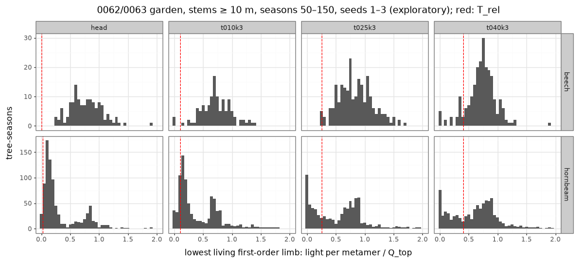
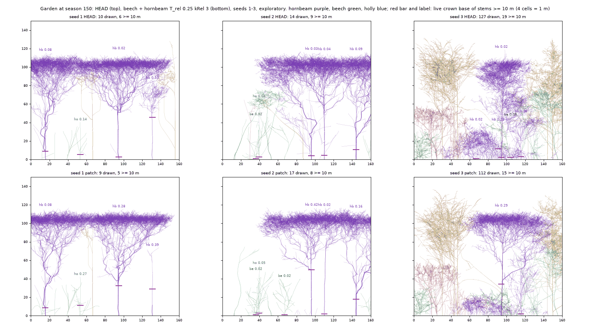

# Does a re-anchored, accumulating T_rel clear beech and hornbeam in the 0062/0063 garden? (the bare-bole probe)

_2026-11-12. Ticket [#126](https://github.com/epabarker/tree-simulation/issues/126) of spec [#111](https://github.com/epabarker/tree-simulation/issues/111), testing the [bare-bole page](../features/bare-bole.md)'s proposal with #125's `c5.kRel`. Code at `ticket/126` (base `spec/111-feature-playbook` dc4f944, the accepted 0062/0063 garden of #121). **Exploratory: the garden and every patched run rest on seeds 1–3.** HEAD's lone trees run seeds 1–20 for the guard's noise floor. No rounded-crown patch; no shipped params change._

## Method
- **Worlds.** The 0062/0063 garden: `forestParams(160, seed)`, 40 × 16 m, periodic in x and z, 400 saplings/ha, `twoPart` mortality, the cap at 160 live trees. Run 150 seasons. The lone open-grown stage: `loneTreeParams(species, seed)`, the 60 m box (ADR 0062), 100 seasons.
- **Numbers.** `rust/core/examples/bole_limbs.rs` runs each params file as the headless runner does (`World::step`, no events). After every season it writes, per live tree ≥ 1.3 m, the core's measures (`liveCrownBase`, `crownLength`, `topFifthLeaf`, `leafBelowSixth`, the shed causes `shedRelative`/`shedCarbon`/`shedBoth`, `boleSprouts`) and each living first-order limb's light read as C5 reads it: Q_b/n_b over the crown's Q_top. `lowRatio` is the lowest living limb's, the one that sets the live crown base; `medRatio` and `minRatio` are over all living limbs. The ratio is read after the shed phase, so it is the light of the limbs that survived it. Params: `code/2026-11-12-bole-probe/params.ts`; runs: `run.sh` (at most 4 at once); tables: `summary.py`.
- **Stand trees** are stems ≥ 10 m. **Gap trees** stand in for the page's edge trees, because the periodic garden has no edges: a stem with no other stem ≥ 0.8 of its height within 5 m, wrapped on both axes. It is a proxy.

## Step 1: the lowest limbs' light at HEAD of the new garden (before any sweep)

Stems ≥ 10 m, seasons 50–150, seeds 1–3; ratios as tree-season quantiles (q10 / median / q90).

| species | trees | tree-seasons | lowest limb ÷ Q_top | all limbs' median | lowest is the darkest limb | live crown base (median) | T_rel |
|---|---|---|---|---|---|---|---|
| beech | 2 | 130 | 0.46 / 0.76 / 1.12 | 1.06 | 9% | 0.023 | 0.008 |
| hornbeam | 11 | 832 | 0.06 / **0.17** / 0.85 | 0.33 | 17% | 0.021 | 0.025 |
| holly | 2 | 202 | 0.33 / 0.75 / 1.32 | 1.10 | 37% | 0.058 | 0.021 |

- **The new stand darkens hornbeam's lowest limbs, not beech's.** Hornbeam's median lowest limb sits at 0.17 of Q_top, below the swept 0.25 and 0.4 and above 0.1 (the old garden's early look: 0.22 at HEAD). Its median limb sits at 0.33, so the lowest limb is darker than most of its crown, though the darkest limb in only 17% of tree-seasons. A T_rel sweep can act on hornbeam.
- **Beech's lowest limbs are lit at 0.46–1.1 of Q_top** (median 0.76), brighter than in the old garden (0.26). Its median limb is at 1.06. Only two beech reach 10 m in three seeds (seed 2 from season ≈ 50, seed 3 near 150). A T_rel below ≈ 0.45 cannot reach them; one above it would cut the crown's median limbs first.
- **The stand is open, not closed.** Seeds 1 and 2 hold 10–16 drawn stems at seasons 100–150 (160–250/ha), 6–12 of them ≥ 10 m; seed 3 floods to 119–127 drawn stems under 17–19 tall ones. The tallest stems are 29–33 m. The few beech stand in this open canopy, lit from the side.
- **Gap trees** are 43% of beech's tall tree-seasons and 69% of hornbeam's: in this stand most tall stems have no neighbour of 0.8 H within 5 m. Hornbeam's gap trees have the darker lowest limbs (median 0.15 against 0.27 for closed ones), the opposite of the edge effect the page expects; with 11 trees this is not a finding about edges.
- **Sanity:** `q_sum` and `n_sum` are written only by C3's allocation pass, so the ratio read after `step` is this season's.

## Step 2: the T_rel × k grid

Beech and hornbeam at T_rel 0.1 / 0.25 / 0.4 × kRel 3 / 6; holly at 0.021, kRel 1; every other species fitted. Stems ≥ 10 m, seasons 100–150, seeds 1–3 pooled (tree-season medians).

| | HEAD | 0.1, k3 | 0.25, k3 | 0.4, k3 | 0.1, k6 | 0.25, k6 | 0.4, k6 |
|---|---|---|---|---|---|---|---|
| **1. live crown base, beech** (trees) | 0.022 (2) | 0.025 (3) | 0.021 (2) | 0.038 (5) | 0.062 (4) | 0.023 (1) | 0.022 (4) |
| **1. hornbeam** (trees) | 0.022 (10) | 0.075 (9) | **0.15** (8) | 0.075 (12) | 0.021 (11) | 0.10 (10) | 0.075 (8) |
| hornbeam tree-seasons in 0.3–0.45 | 0 / 411 | 0 / 418 | 14 / 408 | 23 / 435 | 2 / 434 | 6 / 426 | 13 / 408 |
| 1. holly ≥ 10 m (trees) | 0.058 (2) | 0.047 (1) | 0.055 (2) | 0.043 (3) | 0.048 (2) | 0.054 (1) | 0.051 (2) |
| 2. hornbeam's lowest limb ÷ Q_top, seasons 50–150 (median) | 0.17 | 0.25 | 0.63 | 0.68 | 0.23 | 0.59 | 0.52 |
| 2. beech's | 0.76 | 0.72 | 0.82 | 0.75 | 0.73 | 0.61 | 0.64 |
| 3. hornbeam first-order sheds ≥ 10 m: relative / carbon / both | 1 / 576 / 134 | 117 / 543 / 76 | 504 / 367 / 222 | 612 / 320 / 215 | 30 / 665 / 8 | 268 / 608 / 30 | 386 / 720 / 40 |
| 3. C5's share (relative + both) | 0.19 | 0.26 | 0.66 | 0.72 | 0.05 | 0.33 | 0.37 |
| 3. beech's share (all stems) | 0 | 0.01 | 0.03 | 0.15 | 0 | 0 | 0.04 |
| 4. hornbeam leaf in the top fifth / crown length (m) | 0.73 / 28.2 | 0.71 / 26.0 | 0.85 / 23.6 | 0.72 / 21.2 | 0.65 / 27.0 | 0.67 / 24.7 | 0.80 / 26.4 |
| 4. beech | 0.15 / 11.0 | 0.17 / 9.8 | 0.14 / 11.5 | 0.12 / 11.6 | 0.25 / 10.2 | 0.13 / 10.7 | 0.11 / 11.0 |
| 7. bole sprouts on hornbeam ≥ 10 m (1,140–1,180 tree-seasons each) | 30 | 44 | **145** | 109 | 32 | 84 | 116 |

- **No cell clears the bole.** Beech's live crown base stays 0.02–0.06 in every cell; no beech tree-season ≥ 10 m reaches 0.3. Hornbeam's best cell is 0.25, k3 at a median 0.15, with 3% of its tree-seasons in the band. Seeds agree: per seed, hornbeam reaches 0.14–0.16 at 0.25, k3 and ≤ 0.14 elsewhere.
- **Beech: the rule never reaches the lowest limbs.** They are lit at 0.6–0.8 of Q_top in every cell, above even 0.4, and C5 takes at most 15% of beech's first-order sheds (0.4, k3). The few beech ≥ 10 m are 10–12 m stems in an open canopy (step 1).
- **Hornbeam: the rule acts and clears the scaffold, but sprouts re-clothe the bole.** From T_rel 0.25 C5 takes 33–72% of the tall hornbeam's first-order sheds (19% at HEAD). The surviving lowest limbs are lit (0.5–0.7 of Q_top): the dark ones went. But in 57–75% of tall hornbeam tree-seasons at T_rel ≥ 0.25 (16% at HEAD) the lowest living limb is a one- or two-metamer shoot, and sprouts from bole scars rise 3–5× (30 at HEAD, 84–145). Those shoots carry a live bud, so the live crown base reads them.
- **k 6 sheds less than k 3** at every T_rel (C5's share 0.05–0.37 against 0.26–0.72) and never clears more: a limb must stay dark six seasons in a row, and one bright season resets it.
- **Holly stays clothed** (0.04–0.06), as it would in any cell: its T_rel is unchanged.
- **Lid and crown depth.** Hornbeam's canopy crowns are already a flat lid at HEAD: 73% of their leaf in the top fifth, a 20 m wide layer at 25–28 m over long limbs (the figure's top row). 0.25, k3 deepens that to 85% (1.15× HEAD) and shortens the live crown 28 → 24 m; 0.4, k3 to 21 m. Beech's crowns barely change. The patch does not make the lid; it strips what hangs below it.

### The scaffold under the sprouts

Set the one-shoot sprouts aside and read the lowest living limb of at least 10 metamers (`bigBase`, the scaffold):

| hornbeam ≥ 10 m, seasons 100–150 | HEAD | 0.1, k3 | 0.25, k3 | 0.4, k3 | 0.1, k6 | 0.25, k6 | 0.4, k6 |
|---|---|---|---|---|---|---|---|
| lowest limb a sprout (≤ 2 metamers) | 16% | 31% | 57% | 66% | 18% | 63% | 75% |
| scaffold base ÷ height (median) | 0.034 | 0.10 | **0.29** | 0.20 | 0.08 | 0.18 | 0.25 |
| scaffold in 0.3–0.45 | 0% | 0% | 13% | 16% | 1% | 13% | 30% |
| per seed 1 / 2 / 3 | 0.08 / 0.02 / 0.03 | 0.10 / 0.16 / 0.02 | 0.28 / 0.42 / 0.17 | 0.15 / 0.20 / 0.31 | 0.10 / 0.02 / 0.07 | 0.17 / 0.18 / 0.15 | 0.42 / 0.18 / 0.27 |

- **At 0.25, k3 the relative test clears hornbeam's scaffold to about 0.3 of its height**, the band's floor, in seeds 1 and 2; seed 3 reaches 0.17. Beech's scaffold base equals its live crown base (no sprouts): 0.02–0.06 in every cell.
- So for hornbeam the bole fails on **re-clothing**, not on the rule: R4 releases dormant buds on the scars the relative test leaves, and those shoots are the lowest living limbs. The ticket's bar counts them twice, as live crown base and as re-clothing. A rule to stop them (no release below the live crown, or scar buds dying with the limb) is new mechanism, outside this spec.

## Edge trees (the gap proxy)

The periodic garden has no edges, so gap trees (no stem ≥ 0.8 H within 5 m) stand in. Hornbeam ≥ 10 m, seasons 100–150, live crown base (median; trees):

| | HEAD | 0.1, k3 | 0.25, k3 | 0.4, k3 | 0.1, k6 | 0.25, k6 | 0.4, k6 |
|---|---|---|---|---|---|---|---|
| gap | 0.022 (8) | 0.084 (8) | 0.16 (8) | 0.075 (7) | 0.046 (6) | 0.11 (6) | 0.076 (7) |
| closed | 0.062 (3) | 0.021 (2) | 0.012 (1) | 0.057 (5) | 0.021 (5) | 0.066 (4) | 0.058 (1) |

Closed hornbeams do not clear either (0.01–0.07), so no cell fails only because edge-like trees keep deep crowns. Most tall stems are gap trees: the canopy is two or three hornbeam crowns 20 m across. Beech's gap and closed trees are alike (0.02–0.07; 1–3 trees each); holly's 0.04–0.14.

## Step 3: the lone open-grown guard and its noise floor

**Noise floor (HEAD, lone beech, seeds 1–20, season 100).** Seeds 11 and 15 put buds outside the 60 m box (from seasons 89 and 100; ADR 0062's amendment names the same two) and are excluded. Over the 18 held seeds:

| measure | median | CV | HEAD range, q05–q95 ÷ median | two seeds' ratio, q05–q95 |
|---|---|---|---|---|
| leaf below H/6 | 0.069 | 0.19 | 0.68–1.24 | 0.61–1.61 |
| leaf in the top fifth | 0.161 | 0.29 | 0.55–1.36 | 0.50–1.97 |
| live buds | 246,900 | 0.04 | 0.96–1.07 | 0.91–1.09 |
| live crown base | 0.007 | — | the first lateral, at 0.25 m, in 17 of 18 | |

- **The ±25% band on the two leaf shares cannot fail or pass.** A patch changes the run's realisation, so patch against HEAD on the same seed is two draws: the ratio of two HEAD seeds already spans 0.61–1.61 (leaf below H/6) and 0.50–1.97 (top fifth).
- **The guard used here instead:** each patched seed's value must lie inside HEAD's 20-seed range (q05–q95 of the held seeds). The live-bud count, at CV 4%, is the measure that can discriminate; the leaf shares can only catch a gross change.

**Patched lone beech, seeds 1–3, season 100** (the two strongest cells by C5's share; none held a bud outside the box):

| cell | leaf below H/6 | top fifth | live buds ÷ HEAD same seed | live crown base | inside HEAD's range? |
|---|---|---|---|---|---|
| 0.25, k3 | 0.052–0.076 | 0.183–0.189 | 0.81–0.87 | 0.014–0.020 | leaf shares yes; buds **no** (below q05 in 3/3) |
| 0.4, k3 | 0.058–0.074 | 0.183–0.250 | 0.76–0.81 | 0.007–0.019 | leaf below H/6 yes; top fifth 2/3; buds **no** (3/3) |

- **The lone beech keeps its low limbs**: leaf below H/6 stays in HEAD's range, and the live crown base moves only from the first lateral (0.25 m) to 0.5–0.75 m on a 34–38 m tree.
- **But it loses 13–24% of its live buds**, outside HEAD's 20-seed spread (−4% to +7%). C5's relative test alone sheds 50 (0.25) and 95 (0.4) first-order limbs over the three seeds' 100 seasons. It is a thinner crown, not a see-through umbrella. Under the ticket's ±25% wording it would pass; against the measured floor it fails.

## Verdict: fail (exploratory, seeds 1–3)

| bar | best cell (0.25, k3) | any cell |
|---|---|---|
| live crown base 0.3–0.45, stand beech ≥ 10 m | 0.021 | no (≤ 0.062) |
| … stand hornbeam ≥ 10 m | 0.15 (scaffold 0.29) | no (≤ 0.15) |
| holly ≤ 0.1 | 0.055 | yes, every cell |
| lid and crown depth kept | lid 0.85 (1.15×), crown 28 → 24 m | k6 cells closest |
| lone guard | leaf shares in range; buds −13 to −19% | no cell tested holds the bud floor |
| no re-clothing | bole sprouts 30 → 145 | no (T_rel ≥ 0.25: 84–145) |

**No cell passes, so there is no winning cell.** The bare-bole page stays "proposed".

- **Beech:** in the 0062/0063 garden its lowest limbs are lit at 0.6–0.8 of Q_top, brighter than in the old garden. Few beech reach 10 m (1–5 per cell over three seeds), and those stand as 10–12 m stems in a canopy of two or three hornbeam crowns. No T_rel up to 0.4 reaches their low limbs.
- **Hornbeam:** the new stand does darken its lowest limbs (0.17 of Q_top at HEAD), and T_rel 0.25 with k 3 sheds them: C5 does two thirds of the shedding and the scaffold clears to ≈ 0.3 of the height. R4's sprouts from the new scars then re-clothe the bole, so the live crown base stays at 0.15.
- **k:** 3 beats 6 at every T_rel.

## For the map's fog

- The relative test is the right shape for hornbeam once the stand darkens its low limbs; what stops the bole is re-clothing from bole scars. The next question is about R4: should a shed limb's scar keep dormant buds that can release below the live crown?
- For beech, the garden does not make a closed stand around it. At ADR 0065's crown form, the canopy is two or three 20 m hornbeam crowns, and beech stays a lit sub-canopy tree. #129 (crown extent and girth) changes the stand, and ADR 0065 already says this probe may need repeating then.
- The lone guard's leaf-share band needs the 20-seed range, not ±25% of the same seed. The live-bud count is the guard's discriminating measure.

## Caveats
- Seeds 1–3 in the garden, 150 seasons, 1–5 beech and 8–13 hornbeam ≥ 10 m per cell. The hornbeam pool is dominated by two or three canopy trees per seed.
- The ratio is read after the season's shed, so it describes the survivors. The example and the feature probe's treesim runs are the same realisation: their `liveCrownBase` and heights agree at season 150 (0.25, k3, seed 2), and two builds of the example wrote identical rows (HEAD, seed 1).
- Hornbeam's lone guard was not run: the bar names the open-grown beech.
- Figures: [the lowest-limb ratio](figures/2026-11-12-bole-probe-ratio.png); [the garden at season 150, HEAD over 0.25, k3](figures/2026-11-12-bole-probe-garden-t025k3.png), drawn from the feature probe's runs (`npm run probe -- --patch code/2026-11-12-bole-probe/patch-t025k3.json --species hornbeam --lone 1 --widths 160`).

