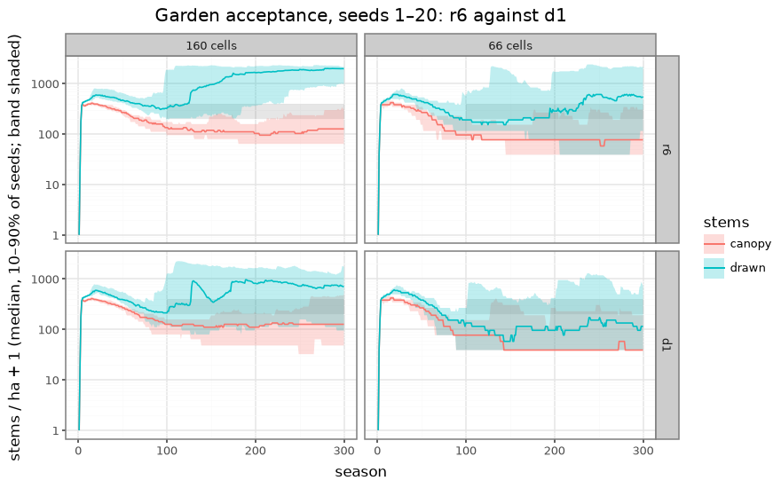

# The garden's 20-seed acceptance: round 6 against d1 (2026-11-12)

**Ticket:** [#122](https://github.com/epabarker/tree-simulation/issues/122), spec [#111](https://github.com/epabarker/tree-simulation/issues/111). Its acceptance is the user's amendment of 2026-11-12 ([ADR 0065](../decisions/0065-garden-demography-reported-targets.md), the issue's last comment).

**Question.** On seeds 1–20, does the garden as #121 landed it (round 6, **r6**) hold a canopy at both widths, and is the named patch **d1** better by the pre-registered rule below? Spec §O4 (the garden's demography), §C2.13 (the light entry); ADRs 0063 and 0065.

## Bars, fixed before the run

Written and committed before any run of this note. Nothing below this section changes them.

### Conditions
- **r6:** HEAD's garden, `forestParams(width, seed)` at `spec/111-feature-playbook` dc4f944 (the #121 merge): round 6's rates, the `carbon` suppression signal.
- **d1:** the same with [`code/2026-11-10-garden-schedule/d1.patch.json`](code/2026-11-10-garden-schedule/d1.patch.json) merged as the feature probe and `sweep.ts` merge it (`mergeParams`, then `patchSpecies`): hornbeam `o4.cSeed` 300 and `o4.suppressionSignal: "topLight"` with θ_q (`topLightThreshold`) 0.15.
- **Widths 160 and 66**, seeds 1–20, 300 seasons, natively. 2 conditions × 2 widths × 20 seeds = 80 runs.
- **Frames:** seasons 100, 200 and 300, so 60 per condition × width.

### Hard gates (each ≥ 18 of seeds 1–20, per condition × width)
1. **A canopy tree at every season after 50:** stand.csv's `canopy` ≥ 1 in every season 51–300. Canopy is ADR 0065's: a drawn stem strictly over half the top height (`topHeight100`, the mean of the 100 tallest drawn stems per hectare; 6 stems at 160 cells, 3 at 66).
   - Under that definition the tallest drawn stem is always over half the mean of the tallest few, so `canopy` ≥ 1 exactly when at least one stem is drawn. The gate reads "no season after 50 without a drawn stem". This is stated, not changed.
2. **At 66 cells, at least one canopy tree at every season from 100** (`canopy` ≥ 1 in seasons 100–300). It is implied by gate 1, so its count is at least gate 1's. Both counts are reported; they differ only if gate 1 fails in seasons 51–99 alone.
3. **For the condition's flora, a checkpoint saved before the change still loads.** A test, not a count:
   - r6 is HEAD, so its checkpoint tests are the suite's (`tests/checkpoint*.test.ts`: the frozen v2 and v3 fixtures and garden 0.14.0's shipped forest).
   - d1 changes params only, no code. Its test: a garden world (`forestParams(66, 1)`, 30 seasons) saved by HEAD's build loads with `RustWorld.load`, takes d1's params by `setParams` (params and hornbeam's species patch), and steps 10 seasons with live trees; two loads stepped alike give the same hash. The frozen fixtures load under the same build.
4. **The lone open-grown tree is bit-identical to before #121.** A test, not a count: `loneTreeParams(species, seed)` for oak and hornbeam (the species d1 patches), seeds 1–3, to season 100. Its state hash under each condition equals the hash of the build before #121 (46f3cf4, its own `loneTreeParams`). The goldens `oakOpen:seed1:s15` and `beechOpen:seed1:s40` (unchanged by #121) are the standing check.

A gate × width passes at ≥ 18 of 20; the count is written beside it either way.

### Reported with counts, not gated
- **Drawn stems/ha in 200–400** at seasons 100/200/300 (per ha = `Math.round(drawn / ha)`, ha = width × 64 × 0.0625 m² / 10⁴). In whole stems that is **13–25 drawn at 160 cells** (0.064 ha: 13 is 203/ha, 26 is 406) and **6–10 at 66 cells** (0.0264 ha: 5 is 189/ha, 11 is 417). Counted as frames in the band, of 60 per condition × width.
- **The canopy share** of drawn stems per frame: its median, and frames at ≥ 0.6.
- **Seasons at the cap:** `meta.capSeasons` in run.json (cross-checked against stand.csv's `capReached`), summed over the 20 seeds; also the cap-free runs and the median.
- **The top species' share** per frame (stand-species.csv `share`). The 70% bar is read only in frames with **≥ 8 drawn stems** (ADR 0065 decision 4): frames judged, frames passing (share ≤ 0.70), and the pass fraction. Frames with fewer than 8 drawn stems are not judged.
- **The oak, for #124:** at seasons 150 and 300, the runs with a live oak (any height, metrics.csv `alive` 1), a drawn oak (height ≥ 5.2 cells), and a seeding oak (a live oak with `seeds` > 0 in that season, and in the ten seasons s−9…s); and the oaks recruited after the planting (tree ids past the planted count) over the run.
- The wall time of the whole run and the median per run.

### The pre-registered choice
- **d1 is recommended only if both hold:**
  1. it passes every hard gate at both widths (≥ 18 of 20 each, and both tests), and its count is no lower than r6's on any hard gate × width;
  2. it is **better** than r6 on at least two of these three, each pooled over both widths (120 frames or 40 runs per condition), a tie counting as not better:
     - **frames in the band:** more frames;
     - **seasons at the cap:** fewer seasons, summed over the 40 runs;
     - **the 70% bar:** a higher pass fraction among judged frames (≥ 8 drawn stems). If either condition has fewer than 10 judged frames, compare failing frames instead: fewer is better.
- **Otherwise r6 is recommended.**
- **If a hard gate fails in both conditions** (fewer than 18 of 20 at either width, or a test fails), the ticket's fail path applies: stop and report, and recommend neither.
- Per-width counts, the canopy share and the oak are reported beside the rule and do not enter it.

## Setup

- **Command:** `npm run evidence:garden` ([`cli/garden-acceptance.ts`](../../cli/garden-acceptance.ts)): the 80 runs natively on 8 simulators (desktop first; resumable), the two tests, the summary and the pre-registered choice. It writes `runs/garden-acceptance/<condition>/{w<width>-s<seed>/, summary.json}`, `lone/` and `tests.json` (not committed).
- **Figure:** `uv run --project analysis python docs/experiments/code/2026-11-12-garden-acceptance/figure.py`.
- **Build:** the runs' `meta.commit` is 8671f08 (this note's bars commit, on dc4f944; the core is dc4f944's).
- **Wall time:** 25.5 min in all (the 80 runs 24.3 min, then the tests), started at load average 5.5 with other work on the laptop. Per run (median): 198 s (r6) and 211 s (d1) at 160 cells, 80 s and 76 s at 66.
- **Before #121:** the lone-tree hashes were recorded once from 46f3cf4's own build and its own `loneTreeParams` (sources exported with `git archive`); the script carries them as `PRE121_LONE`.

## Results

### Hard gates

| gate | r6, 160 | r6, 66 | d1, 160 | d1, 66 |
|---|---|---|---|---|
| 1. a canopy tree every season after 50 | **20 of 20** | **20 of 20** | **20 of 20** | **18 of 20** |
| 2. a canopy tree every season from 100 (66 only) | | **20 of 20** | | **18 of 20** |
| fewest canopy trees after season 50 (per seed) | 3–10 | 1–3 | 1–8 | 0–3 |
| 3. checkpoint saved before the change loads | pass | pass | pass | pass |
| 4. lone tree bit-identical to before #121 | 6 of 6 hashes | (same) | 6 of 6 hashes | (same) |

- **d1 at 66 fails gate 1 in seeds 7 and 14:** no drawn stem for two seasons each (124–125 and 226–227). That is a gap phase on the phone, which r6 never has. It still passes the bar (18 of 20), but its count is below r6's.
- **Gate 3:** at both conditions, the frozen v2 and v3 fixtures and garden 0.14.0's shipped forest load. A garden world saved by HEAD (66 cells, seed 1, season 30) loads, takes the condition's params (d1: `topLight`, hornbeam `cSeed` 300 read back), and grows 10 seasons with live trees; two loads give the same hash.
- **Gate 4:** oak and hornbeam, seeds 1–3, season 100. Under both conditions the hashes equal 46f3cf4's: oak 9d18cdbd, 175ce3f9, 66d455d6; hornbeam 859812b6, 66b88c89, f4a96f3e. d1 cannot reach the lone tree (O4 is off there; `cSeed` is read only by O4).

### Reported counts

Frames are seasons 100/200/300 × 20 seeds = 60 per condition × width.

| count | r6, 160 | r6, 66 | d1, 160 | d1, 66 |
|---|---|---|---|---|
| frames in the band (200–400 drawn/ha) | 13 of 60 | 10 of 60 | 8 of 60 | 5 of 60 |
| … at 100 / 200 / 300 | 10 / 2 / 1 | 4 / 3 / 3 | 6 / 0 / 2 | 2 / 3 / 0 |
| median drawn/ha at 100 / 200 / 300 | 321 / 1,641 / 1,954 | 189 / 284 / 549 | 211 / 821 / 704 | 133 / 95 / 114 |
| canopy share, median | 0.14 | 0.39 | 0.26 | 0.96 |
| frames with canopy share ≥ 0.6 | 1 of 60 | 14 of 60 | 15 of 60 | 41 of 60 |
| seasons at the cap, summed | 4,608 | 3,655 | 2,580 | 879 |
| cap-free runs; median seasons at the cap | 0 of 20; 235 | 0 of 20; 187 | 2 of 20; 144 | 5 of 20; 15 |
| frames judged for 70% (≥ 8 drawn) | 59 | 31 | 52 | 13 |
| frames passing (top share ≤ 0.70) | 23 (39%) | 8 (26%) | 28 (54%) | 2 (15%) |
| top species, frames (of 60) | hornbeam 40, beech 11, maple 6 | hornbeam 36, beech 20 | hornbeam 43, beech 7, birch 6, oak 3 | hornbeam 46, beech 10, birch 3 |

`meta.capSeasons` equals stand.csv's `capReached` rows in all 80 runs.

### The oak (for #124)

Counts are runs of 20, not trees: a run counts if it has at least one such oak. Most live oaks in a run are seedlings (r6 desktop seeds 11 and 20 hold 19 and 33 at 150). "Seeding" is a live oak with seeds > 0 in that season (in the ten seasons up to it in brackets).

| | r6, 160 | r6, 66 | d1, 160 | d1, 66 |
|---|---|---|---|---|
| runs with a live oak at 150 (each also has a drawn one) | 17 | 8 | 14 | 6 |
| seeding at 150 | 4 (6) | 3 (4) | 4 (6) | 3 (5) |
| runs with a live oak at 300 (each also has a drawn one) | 7 | 4 | 8 | 2 |
| seeding at 300 | **0** (0) | 4 (4) | 4 (5) | 2 (2) |
| oak recruits over the run (all seeds); reached 1.3 m | 1,350; 4 | 700; 13 | 4,219; 198 | 2,153; 74 |

- **The oak barely regenerates under r6.** Of 1,350 desktop recruits only 4 reach the display threshold; at season 300 seven desktop runs hold an oak and none seeds. A live oak at 300 is mostly a planted survivor.
- **d1 recruits more oaks and lets more of them up** (198 desktop recruits reach 1.3 m; three desktop frames have oak on top), but on the phone it keeps an oak at 300 in only 2 runs.
- ADR 0065 expected the dark-top signal to weaken the oak. Here it does not at 160 cells (seeding at 300 in 4 runs against 0); at 66 it holds fewer oaks at 300 (2 against 4).

### The pre-registered choice: r6

1. **Hard gates:** both conditions pass every gate at both widths and both tests. **d1's count is lower than r6's on gates 1 and 2 at 66 cells** (18 against 20 of 20). The rule's first condition for d1 fails here.
2. **Better on at least two of three (pooled over both widths):**
   - frames in the band: d1 13, r6 23. **Not better.**
   - seasons at the cap: d1 3,459, r6 8,263. **Better.**
   - the 70% bar: d1 30 of 65 judged (46%), r6 31 of 90 (34%). **Better.**

   d1 is better on two, so this condition holds.
3. **The rule picks r6**, on condition 1 alone: d1's two-season phone gaps (seeds 7 and 14).

The fail path does not apply: neither condition fails a hard gate.

### Beside the rule (not part of it)
- **Neither condition is a mature high forest** (the per-hectare targets, now #129's). r6's desktop understorey floods after season 100 (median 1,641–1,954 drawn/ha, canopy share 0.08–0.09 at 200/300). d1 floods less (704–821/ha) and keeps more canopy share.
- **The phone under d1 is sparse:** median 95–133 drawn/ha, mostly one canopy crown (share 0.96). That is why its band count is low and why two seeds lost every drawn stem for two seasons.
- **d1 halves the cap seasons and gives the 70% bar its best pass rate on the desktop** (54% against 39%), but hornbeam still tops 89 of 120 frames.
