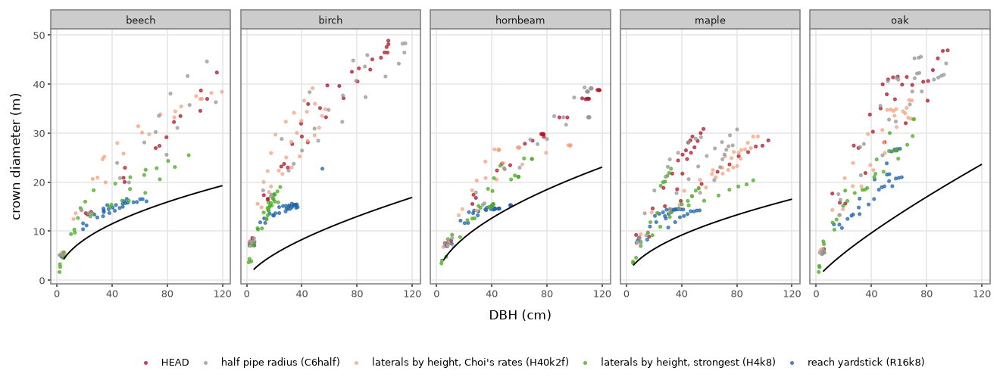
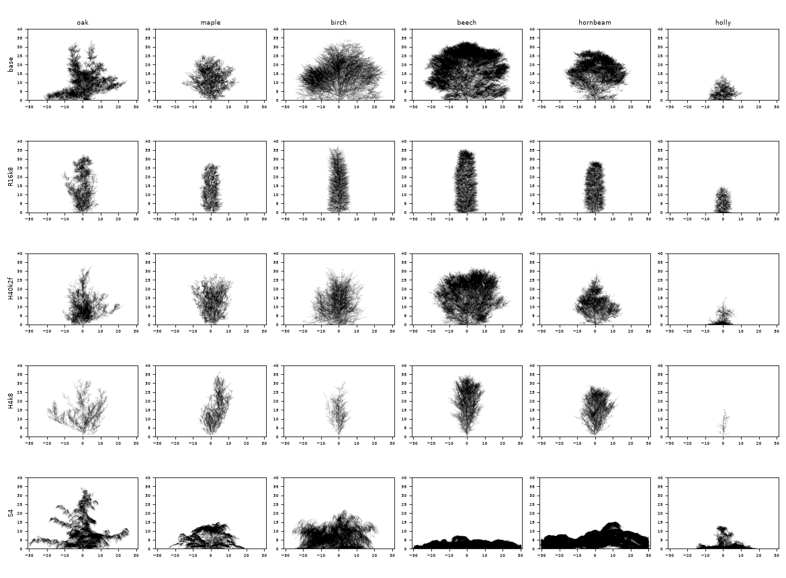

# Which mechanism brings crown extent and girth into range? (2026-11-13)

**Ticket:** [#129](https://github.com/epabarker/tree-simulation/issues/129), acceptance criterion 1 only: a probe that chooses a mechanism or rejects them all. **Exploratory: seeds 1–3.** Nothing is adopted: every rule is a probe param, off by default and bit-identical, and no preset, species or golden changes. Branch `probe/129-crown-extent`, cut from `3d-port` bdacf98.

**Question.** The [path-length probe](2026-11-11-garden-pathlength-probe.md) found the crowns 1.4–4.2× Pretzsch et al. 2015's open-grown edge at matched DBH and the stems 2–3× too thick for their age, and left four questions (its §10). Which of these brings the lone tree into the open-grown envelope and the garden to [ADR 0065](../decisions/0065-garden-demography-reported-targets.md) decision 1's targets: lateral shoots slowed by the tree's size with the leader spared, a C6 girth recalibration, or both? Spec §C1 (shoot extension), §C6 (girth), §O4 (the garden's demography); ADRs 0062, 0063, 0065.

## Answer (written after the runs)

**No arm is chosen: by the rule fixed below, all are rejected.** The closest is `H4k8`, the lateral-slowing rule at its strongest, and it is the first arm in any probe to hold the canopy count.

- **The emergent rule at Choi's rates does too little.** Slowed by tree height (`H40k2f`), the lone crowns are 8–25% narrower with the height kept, and still 1.3–4.2× the open-grown edge. Slowed by path length (`P60k2f`), they are as wide as at HEAD.
- **At its strongest it halves the lone crown and keeps the height, and still fails the lone bar.** With `H4k8` a level shoot barely extends once the tree is over about 1.5 m tall. The lone beech is 23–26 m across (50–52 m at HEAD) and the hornbeam 16–25 m (30–39 m), at 1.47–1.57× and 1.21–1.45× the edge at season 100. The bar is 1.2 in every seed. The ratio falls so little because the stem thins with the crown.
- **In the garden `H4k8` meets the canopy-count target in 3 of 3 desktop runs:** a median of 203, 281 and 250 canopy trees/ha from season 100, never under 141, against 78, 156 and 172 at HEAD. The stand hornbeam's stem at season 100 is 37 cm (69 cm at HEAD; Lockow's table has 26–36) and its crown 13.1 m (19.5 m).
- **The band and the canopy share get worse.** Narrow crowns light the floor: 1,000–2,450 drawn stems/ha from season 100 and the cap reached in 283–284 of 300 seasons, in every run. Both targets hold in 0 of 9 frames (2 and 1 at HEAD). The understorey was out of scope; it is now the first thing in the way.
- **Its thin stems are thrown.** R3 throws 26 of the 79 planted trees over the three desktop runs (8 at HEAD). The lone birch is 31–34 m tall on a 20–24 cm stem.
- **Girth is not C6's to recalibrate.** Halving the pipe radius (`C6half`) leaves DBH where it was, because 63% of the bole's radius is R3's stress wood, added until bending stress meets `r3.sigmaTarget`. Raising that target fourfold (`S4`) thins nothing useful: the limbs sag to the ground and the lone beech is 8–10 m tall and 61 m across.
- **"Stems 2–3× too thick" is the wide crown's doing.** With the crown narrowed the stand hornbeam's stem is in the yield table's range, and the lone trees' stems are, if anything, too thin for their height. A crown rule would need girth moved the other way.
- **Planting 1,000/ha** on top of `H4k8` holds more canopy trees at season 100 (19, 28 and 29 on the plot, against 15, 19 and 20) and no more at season 300 (9–12 against 11–20).



Each point is one lone tree at one snapshot (every 10 seasons to 100, seeds 1–3). The line is Pretzsch et al. 2015's open-grown 95% edge; a lone tree should sit on or under it.

## The user's answers to §10 (2026-11-13, before any code)

1. **An imposed crown radius is not a candidate.** The candidate is an emergent rule: shoots slowed by the tree's size, upright ones spared. The reach limit is run as it was on `probe/121-pathlength`, as a yardstick only. Choosing it would need a new ask and its own ADR.
2. **Girth is recalibrated with the crown rule:** a 2×2 of C6 (as fitted, thinned) by crown rule (off, on).
3. **Planting density:** every arm at 400 saplings/ha; the leading arm alone is repeated at 1,000/ha.
4. **The understorey at the cap is out of scope.** No establishment, bank or cap tuning. Its counts are reported.
5. (Settled by ADR 0065: a canopy stem is a drawn stem over half the top height.)

Two design choices were also put to the user and agreed: the leader is spared **by the bud's own heading** (not by position in the crown or by axis), and the tests sit at four seams (g, the chance, `grow_buds`, the World's hash).

## Bars and the rule for choosing, fixed before the runs

Written and committed before any arm was run. Nothing below this section changes them.

### The rule under test (`c1.extentLimit`, probe only)
- A shoot extends this season with a chance p, drawn once per live bud and season; a barred bud rests as one below its threshold does. g(L) = max(g_min, 1 / (1 + (L / L_x)^k)), with L read at the bud's node as the season began.
- **L** (`c1.extentLimit`): `reach`, the node's horizontal distance from the stem base; `height`, the tree's height; `path`, the node's path length from the stem base.
- **Sparing** (`c1.extentSpare`): p = u² + (1 − u²)·g, where u is the upward part of the bud's heading (0 for a level or drooping bud). Without it p = g.
- It is one rule with one g (the path-length note §9). The arms differ only in L and in sparing.

### Arms
| arm | what | patch |
|---|---|---|
| `base` | HEAD: round 6's garden (r6), the fitted species | none |
| `R16k8` | the yardstick: reach, L_x 16, k 8, no floor, no sparing (the path-length note's closest condition) | `patches/R16k8.json` |
| `H40k2f` | laterals slowed by tree height, leader spared: L_x 40 (10 m), k 2, g_min 0.1. Choi et al. 2001's exposed-margin rates give g 0.5, 0.2 and 0.1 at 10, 20 and 30 m | `patches/H40k2f.json` |
| `P60k2f` | the same by path length (local): L_x 60 (15 m), k 2, g_min 0.1 | `patches/P60k2f.json` |
| `C6half` | girth alone: every species' `c6.r0` halved with m_w·r0² kept (`r1.mw` × 4), so R1's wood cost is unchanged and every radius on the same skeleton is half | `patches/C6half.json` |
| leading arm × `C6half` | the 2×2's fourth cell | |
| leading arm at 1,000/ha | `o4.planting.density` 1000 | |

- **Calibration variants** of the emergent rule (L_x, k, g_min) may be screened on the lone beech and hornbeam before the garden is run. Every variant run is reported.
- **Stages:** the lone open-grown tree (`loneTreeParams`, the 60 m box of ADR 0062) for the six exemplars, snapshots every 10 seasons to 100; the garden (`forestParams`) at 160 and 66 cells to season 300, snapshots at 25/50/75/100/150/200/300. Seeds 1–3. All through `npm run probe` (`run.sh`), at most 12 simulators.
- **Measurement:** the path-length note's (`dbh.py`: DBH at 1.3 m by the pipe radius; crown diameter twice the mean crown radius over ±x and ±z; `anchors.py`: Pretzsch's edge). The garden's counts are the core's own `stand.csv`, whose `canopy` is ADR 0065's.

### Bars
- **The lone open-grown envelope** (the path-length note §1.1): crown diameter ÷ Pretzsch's open-grown 95% edge at matched DBH, where the tree first reaches 40 cm and at season 100. A lone tree should sit at or under the edge. Read for the five species with a line (oak, maple by the sycamore's line, birch, beech, hornbeam): **at or under 1.0 passes; 1.0–1.2 is near.**
- **Lone guards, reported:** height at season 100 against `base`; the box held (`budsOutside` 0 in every season); round in plan (≥ 0.75); `w90` (a column has 0.6–0.8); top-fifth leaf; the crown-edge rate over seasons 60–100 (Choi: 2–3 cm/yr at that size).
- **The garden's targets** (ADR 0065 decision 1, owned by #129), at 160 cells:
  1. at least 120 canopy trees/ha: in every season from 100 (runs of 3), and at the frames 100/200/300 (frames of 9);
  2. 200–400 drawn stems/ha at seasons 100/200/300 (frames of 9);
  3. at least 60% of drawn stems in the canopy (frames of 9).
- **Reported beside them:** the seasons at the cap, the top species' share in frames with ≥ 8 drawn stems, the canopy trees' DBH, height and crown at season 100, and at 66 cells a canopy tree in every season from 100.

### The rule for choosing
- **An arm is chosen** (for a 20-seed adoption run, which this probe does not make) only if, on seeds 1–3:
  1. **lone:** beech and hornbeam are at or under 1.2× the edge at DBH 40 and at season 100 in every seed, no species is further over the edge than at `base`, and each species' median height at season 100 is at least 0.9 of `base`'s;
  2. **garden, 160 cells:** the median canopy count from season 100 is at least 120/ha in 3 of 3 runs, and more frames hold ≥ 120/ha than at `base`;
  3. it is not the yardstick.
- Targets 2 and 3 (the band and the canopy share) do not enter the rule, because the understorey is out of scope (answer 4). Their counts are reported and named as what stays red.
- **If no arm meets it, all are rejected,** and the note names the closest and what it lacks.
- **Girth** is judged by the 2×2: whether `C6half` alone or with the leading arm moves the lone ratio and the garden's canopy count in the wanted direction, with the DBH for age (Lockow's hornbeam table: 26–36 cm mean at 100 years) reported.

## 1. The rule as built

`c1.extentLimit`, as the section above states it. In `grow_buds`, one pass reads L at every node as the phase begins (`c1::extent_sizes`); each live bud then draws once against p (`extent_chance` of `extent_scale`), from the RNG purpose `EXTENT_LIMIT` (21), keyed by the tree, the bud's birthId and the season. A barred bud takes the resting branch a bud below its threshold takes. Nothing is stored on the tree, so the checkpoint layout is unchanged.

- **Why a chance and not a shorter internode:** the path-length note §2. A shoot is one metamer from season ≈ 30, and shorter internodes keep their leaf and buds, which floods a shade-tolerant crown.
- **Params:** `c1.extentLimit` (absent: `off`), `c1.extentSpare`, `c1.extentScale` (L_x; absent 60), `c1.extentSteepness` (k; absent 2), `c1.extentFloor` (g_min; absent 0, held in [0, 1]). L_x or k at or under 0 is no limit. This closes the path-length note's defect 4 (unchecked params).
- **Purpose 21 is the number `probe/121-pathlength` used**, so the yardstick draws as that probe drew; 20 is left unused (the unmerged occupancy probe had it).
- **Tests** (in `principles/c1.rs`), at the four seams agreed with the user:
  - g: `the_extent_chance_is_half_at_l_x_falls_as_the_steepness_says_and_keeps_its_floor`;
  - the chance: `an_upright_shoot_is_spared_the_extent_limit_and_a_level_one_takes_it_in_full`;
  - L: `an_extent_size_is_the_reach_the_tree_height_or_the_path_from_the_base`;
  - `grow_buds`: `a_bud_the_extent_limit_bars_rests_alive_and_a_spared_upright_one_grows`, and `the_extent_draw_bars_a_shoot_at_its_chance_and_is_keyed_by_tree_bud_and_season`;
  - the World: `the_extent_limit_is_off_by_default_and_written_out_is_bit_identical`.
  - **How they were written.** Five were red before green, the off-is-bit-identical test first: it failed on its "a reach limit differs" line until the rule existed. The sixth (the draw's rate and keys) was added after the spec reviewer noted that nothing tested the draw at an intermediate chance; it passed when written, so its red state was not observed.
- **Bit-identity, rule off:**
  - the goldens pass unchanged, natively and in WASM (`npm run check:stamp`);
  - `base`'s six garden runs hash as round 6's 20-seed runs do (`runs/garden-acceptance/r6`: 4c635417, 2fc09b10, 67e054cf at 160 cells; 55bc03f7, 133406da, a2645eb4 at 66);
  - `base`'s lone table is the path-length note's §1.1, range for range.
- **The port is faithful:** `R16k8`'s lone table is the path-length note's "reach 16, k 8" rows, range for range.
- **Review.** The `spec-reviewer` sub-agent found no divergence. It confirmed off is bit-identical on its own runs (`oakOpen`, 40 seasons), the draw's keys, the staging and the core's Math, and that no JSON value makes p NaN. Its three unverified questions are in section 8.
- **Not done, because nothing is adopted:** no panel control, no preset, no golden case, no ROADMAP row.

## 2. What was run, and where it left the registered plan

- **The registered arms** all ran: `base`, `R16k8`, `H40k2f`, `P60k2f`, `C6half`.
- **Calibration variants,** screened on the lone hornbeam, beech and birch after `H40k2f` did little: `H16k1f05` (L_x 16, k 1, g_min 0.05), `H16k2` (L_x 16, k 2, no floor), `H8k2f02` (L_x 8, k 2, g_min 0.02) and `H4k8` (L_x 4, k 8, no floor). All are the height form with sparing. `H4k8` is the form's limit: g is under 0.001 once the tree is 2.4 m tall, so p is the squared upward part of the bud's heading. `H8k2f02` and `H4k8` were then run in full.
- **The leading arm is `H4k8`,** by the lone ratio. It has no floor, against the research note's revision; `H8k2f02` is the best arm with one.
- **A girth arm was added: `S4`.** `C6half` did not thin the stems (section 5), so it could not stand as the 2×2's thinned cell. `S4` multiplies every species' `r3.sigmaTarget` and `r3.sigmaBreak` by 4, which on the same load gives a stress-wood radius 0.63 as large. Both crosses were run: `H4k8` × `C6half` (the registered fourth cell) and `H4k8` × `S4`.
- **The denser planting** (`H4k8d1000`) sets `o4.planting` to 1,000/ha with a spacing of 8 cells, not 12: the planting's darts cannot place 64 trees 3 m apart on the desktop plot. It planted 64, 64 and 65 trees at 160 cells and 26 at 66 (985/ha).
- **Two slips, both repaired.** A driver call for `C6half`'s lone trees cleared the label that held its garden runs, which were run again (the same table came back). `S4`'s lone birch was run by a direct probe call, because the probe's contact sheet for `S4`'s beech (723,000–811,000 metamers) exceeded Node's string limit and stopped the driver before birch. The beech runs themselves had finished.
- **No contact sheet was judged for adoption.** The probe wrote one per arm and species (`runs/probe/129-<arm>-<species>/sheet.html`); the silhouettes below were looked at.

## 3. The lone open-grown tree

Season 100, the minimum and maximum of seeds 1–3 (`table.py lone`). "At DBH 40" is where the tree first reaches 40 cm, linear between 10-season snapshots. The edge rate is the gain in mean crown radius over seasons 60–100. `H16k1f05` and `H16k2` have three species (the screen).

| arm | species | height (m) | DBH (cm) | crown diameter (m) | ÷ Pretzsch 95% | at DBH 40: season, height (m), crown (m), ÷ Pretzsch | W/H | edge rate 60–100 (cm/season) | round | box held | top-fifth leaf | w90 | metamers (k) |
|---|---|---|---|---|---|---|---|---|---|---|---|---|---|
| base | oak | 33.0–33.9 | 66–95 | 40.6–46.9 | 2.37–2.87 | 33–41, 21.3–26.7, 23.8–34.5, 2.47–3.58 (3 of 3) | 1.20–1.42 | 1–13 | 0.72–0.93 | 3 of 3 | 0.03–0.05 | 0.16–0.49 | 83–91 |
| base | maple | 25.4–26.8 | 48–103 | 28.5–30.8 | 1.87–2.90 | 20–58, 12.1–21.6, 16.3–25.3, 1.77–2.76 (3 of 3) | 1.09–1.17 | 4–6 | 0.90–0.95 | 3 of 3 | 0.03–0.11 | 0.17–0.57 | 46–47 |
| base | birch | 30.4–35.3 | 102–103 | 46.4–48.8 | 3.05–3.20 | 37–51, 22.2–29.4, 26.6–32.4, 3.21–3.90 (3 of 3) | 1.31–1.61 | 12–14 | 0.86–1.00 | 2 of 3 | 0.02–0.03 | 0.31–0.44 | 111–126 |
| base | beech | 33.6–36.1 | 138–196 | 50.0–51.7 | 2.09–2.51 | 26–27, 10.6–11.8, 17.7–19.9, 1.54–1.73 (3 of 3) | 1.43–1.49 | 14–16 | 0.89–0.99 | 3 of 3 | 0.14–0.17 | 0.39–0.45 | 247–264 |
| base | hornbeam | 29.2–29.3 | 78–118 | 29.8–38.7 | 1.64–1.69 | 25–28, 14.0–21.2, 19.9–21.5, 1.57–1.70 (3 of 3) | 1.02–1.32 | -0–2 | 0.88–0.98 | 3 of 3 | 0.06–0.15 | 0.28–0.50 | 70–110 |
| base | holly | 15.3–15.5 | 23–31 | 16.9–21.0 | – | not reached (0 of 3) | 1.09–1.37 | -0 | 0.88–0.96 | 3 of 3 | 0.01 | 0.13–0.19 | 12–19 |
| R16k8 | oak | 32.7–33.0 | 53–62 | 21.0–26.8 | 1.52–1.98 | 48–51, 25.3–29.8, 16.1–19.7, 1.67–2.04 (3 of 3) | 0.64–0.82 | 1–4 | 0.89–0.96 | 3 of 3 | 0.04–0.14 | 0.32–0.57 | 33–36 |
| R16k8 | maple | 28.4–30.8 | 38–53 | 14.2–14.6 | 1.33–1.64 | 44–94, 18.7–27.2, 12.9–14.4, 1.41–1.57 (2 of 3) | 0.47–0.51 | 0–1 | 0.90–1.00 | 3 of 3 | 0.11–0.13 | 0.66–0.68 | 23–25 |
| R16k8 | birch | 37.8–41.6 | 36–55 | 14.9–22.7 | 1.89–2.24 | 92, 42.1, 17.1, 2.06 (1 of 3) | 0.36–0.55 | 0–10 | 0.76–0.99 | 3 of 3 | 0.05–0.08 | 0.59–0.71 | 37–44 |
| R16k8 | beech | 35.9–39.3 | 56–65 | 15.9–16.5 | 1.11–1.18 | 45–63, 20.3–25.3, 13.9–15.5, 1.21–1.35 (3 of 3) | 0.41–0.46 | 1–2 | 0.92–0.99 | 3 of 3 | 0.15–0.17 | 0.67–0.71 | 56–58 |
| R16k8 | hornbeam | 29.4–29.5 | 43–54 | 14.5–15.2 | 1.02–1.11 | 50–63, 26.9–28.8, 14.5–15.1, 1.14–1.20 (3 of 3) | 0.49–0.52 | -0 | 0.94–0.99 | 3 of 3 | 0.16–0.17 | 0.62–0.75 | 33–37 |
| R16k8 | holly | 15.5–15.9 | 16–23 | 11.1–12.1 | – | not reached (0 of 3) | 0.70–0.77 | 0 | 0.93–0.99 | 3 of 3 | 0.02–0.04 | 0.18–0.62 | 8–13 |
| H40k2f | oak | 32.7–33.2 | 58–71 | 32.9–36.6 | 2.14–2.67 | 38–52, 22.1–31.5, 21.9–30.0, 2.27–3.11 (3 of 3) | 1.01–1.12 | 2–5 | 0.63–0.96 | 3 of 3 | 0.02 | 0.18–0.44 | 41–48 |
| H40k2f | maple | 28.2–30.6 | 83–95 | 24.8–29.3 | 1.83–2.01 | 21–29, 11.8–16.3, 15.7–17.9, 1.71–1.94 (3 of 3) | 0.86–1.04 | 4–5 | 0.86–0.96 | 3 of 3 | 0.06 | 0.47–0.81 | 36–40 |
| H40k2f | birch | 31.8–35.2 | 48–57 | 34.9–39.1 | 3.35–4.21 | 53–88, 25.8–31.5, 26.1–36.1, 3.15–4.35 (3 of 3) | 1.05–1.13 | 8–12 | 0.91–1.00 | 3 of 3 | 0.01–0.02 | 0.15–0.70 | 51–59 |
| H40k2f | beech | 32.6–34.6 | 112–156 | 38.2–45.7 | 2.05–2.09 | 36–46, 14.1–20.1, 23.7–26.8, 2.06–2.33 (3 of 3) | 1.10–1.39 | 8–16 | 0.83–0.95 | 3 of 3 | 0.10–0.11 | 0.47–0.67 | 137–152 |
| H40k2f | hornbeam | 29.2–30.4 | 45–97 | 26.6–27.5 | 1.34–1.97 | 28–47, 16.7–28.5, 19.0–25.9, 1.50–2.05 (3 of 3) | 0.87–0.93 | -0 | 0.84–0.98 | 3 of 3 | 0.01–0.07 | 0.14–0.65 | 46–56 |
| H40k2f | holly | 15.4–15.6 | 19–21 | 14.1–18.2 | – | not reached (0 of 3) | 0.91–1.17 | -0 | 0.91–0.98 | 3 of 3 | 0.00–0.02 | 0.00–0.25 | 6–10 |
| P60k2f | oak | 33.0–34.0 | 69–98 | 33.5–51.4 | 2.24–2.81 | 33–43, 22.0–26.6, 22.7–26.7, 2.35–2.77 (3 of 3) | 0.99–1.56 | 3–22 | 0.90–0.97 | 2 of 3 | 0.01–0.02 | 0.06–0.13 | 51–84 |
| P60k2f | maple | 25.6–28.4 | 55–95 | 26.6–30.3 | 2.06–2.51 | 20–42, 10.7–18.1, 16.4–24.0, 1.79–2.61 (3 of 3) | 1.01–1.17 | 4–6 | 0.89–0.96 | 3 of 3 | 0.02–0.06 | 0.34–0.84 | 41–43 |
| P60k2f | birch | 33.8–38.6 | 58–94 | 46.8–50.2 | 3.39–4.79 | 43–57, 22.7–28.5, 29.0–36.2, 3.50–4.37 (3 of 3) | 1.30–1.44 | 12–15 | 0.78–0.96 | 2 of 3 | 0.00–0.01 | 0.17–0.62 | 94–107 |
| P60k2f | beech | 32.8–34.9 | 132–158 | 42.9–46.0 | 2.05–2.18 | 28–30, 12.6–13.8, 19.1–19.4, 1.66–1.69 (3 of 3) | 1.25–1.37 | 13–14 | 0.93–0.95 | 3 of 3 | 0.10–0.15 | 0.48–0.57 | 165–172 |
| P60k2f | hornbeam | 28.8–29.2 | 56–109 | 29.6–36.3 | 1.66–2.12 | 29–39, 16.3–23.8, 21.3–23.8, 1.68–1.89 (3 of 3) | 1.03–1.24 | -0–3 | 0.86–0.98 | 3 of 3 | 0.06–0.16 | 0.29–0.67 | 68–90 |
| P60k2f | holly | 15.0–15.6 | 21–26 | 15.1–22.1 | – | not reached (0 of 3) | 1.00–1.45 | -0 | 0.86–0.94 | 3 of 3 | 0.01 | 0.19–0.54 | 7–20 |
| H16k1f05 | birch | 31.5–36.5 | 32–62 | 31.5–36.9 | 2.91–4.87 | 64, 27.7, 24.6, 2.97 (1 of 3) | 0.86–1.06 | 10–14 | 0.82–0.98 | 3 of 3 | 0.01–0.03 | 0.19–0.37 | 41–49 |
| H16k1f05 | beech | 32.8–34.5 | 71–119 | 35.6–36.3 | 1.89–2.37 | 48–58, 18.1–21.6, 23.9–26.1, 2.08–2.27 (3 of 3) | 1.03–1.11 | 9–12 | 0.92–0.99 | 3 of 3 | 0.10–0.15 | 0.53–0.72 | 117–125 |
| H16k1f05 | hornbeam | 28.9–29.4 | 52–62 | 24.5–28.7 | 1.68–1.81 | 36–43, 19.2–25.6, 19.9–24.3, 1.58–1.92 (3 of 3) | 0.84–0.99 | -0–2 | 0.90–0.97 | 3 of 3 | 0.02–0.10 | 0.17–0.58 | 37–58 |
| H16k2 | birch | 32.7–37.5 | 21–31 | 17.9–21.1 | 2.53–3.69 | not reached (0 of 3) | 0.48–0.62 | 4–6 | 0.80–0.97 | 3 of 3 | 0.02–0.03 | 0.37–0.82 | 13–19 |
| H16k2 | beech | 32.3–33.4 | 62–95 | 29.6–32.7 | 1.89–2.09 | 43–74, 16.7–26.2, 19.3–25.6, 1.68–2.23 (3 of 3) | 0.89–1.01 | 9–12 | 0.97–0.99 | 3 of 3 | 0.11–0.13 | 0.60–0.71 | 83–89 |
| H16k2 | hornbeam | 28.8–30.1 | 36–90 | 18.6–28.9 | 1.47–1.55 | 29–46, 14.5–25.2, 17.5–19.8, 1.39–1.57 (2 of 3) | 0.65–1.00 | -0–2 | 0.91–0.98 | 3 of 3 | 0.02–0.09 | 0.22–0.34 | 26–57 |
| H8k2f02 | oak | 33.3–33.8 | 41–79 | 23.1–38.5 | 2.05–2.34 | 43–66, 26.3–33.1, 18.5–25.3, 1.92–2.62 (3 of 3) | 0.70–1.15 | 2–14 | 0.70–0.87 | 3 of 3 | 0.03–0.04 | 0.10–0.23 | 19–27 |
| H8k2f02 | maple | 27.6–33.1 | 73–84 | 21.7–23.0 | 1.66–1.80 | 41–46, 16.7–18.9, 15.0–16.3, 1.63–1.77 (3 of 3) | 0.66–0.83 | 6 | 0.85–0.95 | 3 of 3 | 0.03–0.08 | 0.24–0.73 | 25–26 |
| H8k2f02 | birch | 29.3–34.4 | 20–28 | 16.0–18.5 | 2.47–3.33 | not reached (0 of 3) | 0.52–0.60 | 2–6 | 0.84–0.98 | 3 of 3 | 0.03–0.08 | 0.46–1.00 | 11–14 |
| H8k2f02 | beech | 32.9–33.5 | 49–83 | 25.2–26.7 | 1.65–1.99 | 51–78, 19.7–27.2, 18.1–22.7, 1.58–1.97 (3 of 3) | 0.77–0.80 | 8–9 | 0.94–0.97 | 3 of 3 | 0.09–0.14 | 0.53–0.62 | 61–67 |
| H8k2f02 | hornbeam | 29.3–29.6 | 33–55 | 18.9–22.6 | 1.44–1.85 | 40–51, 22.2–28.9, 18.5–19.4, 1.47–1.54 (2 of 3) | 0.64–0.76 | -0 | 0.87–0.95 | 3 of 3 | 0.01–0.05 | 0.12–0.37 | 26–32 |
| H8k2f02 | holly | 15.3–16.8 | 11–16 | 8.7–12.9 | – | not reached (0 of 3) | 0.52–0.84 | -0 | 0.73–0.96 | 3 of 3 | 0.02–0.03 | 0.07–1.06 | 1–3 |
| H4k8 | oak | 32.8–34.1 | 53–71 | 26.5–32.8 | 2.01–2.46 | 53–65, 27.5–31.9, 19.7–20.4, 2.05–2.12 (3 of 3) | 0.78–1.00 | 7–14 | 0.87–0.96 | 3 of 3 | 0.03–0.07 | 0.28–0.36 | 16–19 |
| H4k8 | maple | 26.7–36.5 | 32–92 | 18.7–22.7 | 1.42–2.77 | 36–60, 16.3–24.8, 14.4–15.4, 1.56–1.68 (2 of 3) | 0.56–0.85 | 3–4 | 0.70–0.93 | 3 of 3 | 0.07–0.10 | 0.39–0.75 | 18–22 |
| H4k8 | birch | 30.8–33.9 | 20–24 | 15.9–19.0 | 2.75–3.32 | not reached (0 of 3) | 0.48–0.57 | 2–4 | 0.89–0.97 | 3 of 3 | 0.03–0.06 | 0.35–0.45 | 8–9 |
| H4k8 | beech | 32.7–37.9 | 64–96 | 22.5–25.5 | 1.47–1.57 | 50–78, 17.7–30.1, 15.2–19.5, 1.32–1.70 (3 of 3) | 0.64–0.74 | 8–12 | 0.82–0.98 | 3 of 3 | 0.11–0.16 | 0.42–0.71 | 43–47 |
| H4k8 | hornbeam | 29.1–30.3 | 41–69 | 15.5–24.7 | 1.21–1.45 | 49–56, 23.8–28.9, 14.9–20.0, 1.18–1.58 (3 of 3) | 0.52–0.85 | 1–5 | 0.88–0.99 | 3 of 3 | 0.02–0.16 | 0.33–0.65 | 12–35 |
| H4k8 | holly | 15.6–16.1 | 11–13 | 6.6–8.6 | – | not reached (0 of 3) | 0.41–0.55 | 0 | 0.69–0.86 | 3 of 3 | 0.05–0.11 | 0.00–0.67 | 1 |
| C6half | oak | 32.6–33.6 | 75–94 | 42.3–45.6 | 2.28–2.80 | 34–35, 22.0–23.4, 23.4–31.3, 2.42–3.25 (3 of 3) | 1.26–1.40 | 4–8 | 0.79–0.91 | 3 of 3 | 0.02–0.03 | 0.14–0.17 | 73–85 |
| C6half | maple | 24.0–28.8 | 54–80 | 27.5–30.7 | 2.11–2.70 | 21–73, 13.1–22.1, 15.1–26.7, 1.64–2.90 (3 of 3) | 1.05–1.21 | 4–7 | 0.83–0.97 | 3 of 3 | 0.05–0.12 | 0.37–0.74 | 44–48 |
| C6half | birch | 29.8–34.2 | 87–179 | 45.9–48.3 | 2.16–3.34 | 33–40, 23.9–28.1, 25.3–35.7, 3.05–4.31 (3 of 3) | 1.34–1.59 | -1–14 | 0.92–0.96 | 2 of 3 | 0.03–0.04 | 0.46–0.66 | 106–125 |
| C6half | beech | 33.7–35.8 | 139–202 | 49.8–53.5 | 2.05–2.41 | 25–29, 10.5–12.9, 17.1–22.5, 1.49–1.96 (3 of 3) | 1.39–1.59 | 15–17 | 0.94–0.96 | 3 of 3 | 0.16–0.20 | 0.43–0.55 | 244–266 |
| C6half | hornbeam | 29.0–29.1 | 110–112 | 33.2–39.1 | 1.51–1.76 | 22–26, 12.3–14.8, 17.2–20.7, 1.36–1.64 (3 of 3) | 1.15–1.34 | -0–2 | 0.88–0.97 | 3 of 3 | 0.05–0.17 | 0.20–0.55 | 87–104 |
| C6half | holly | 15.2–15.3 | 18–37 | 15.3–24.5 | – | not reached (0 of 3) | 1.00–1.61 | -0–1 | 0.88–0.97 | 3 of 3 | 0.01 | 0.09–0.27 | 10–26 |
| S4 | oak | 33.2–35.9 | 49–52 | 39.3–47.7 | 3.34–4.02 | 66–67, 30.4–34.2, 35.8–46.7, 3.72–4.84 (3 of 3) | 1.18–1.37 | 4–15 | 0.68–0.93 | 2 of 3 | 0.03–0.06 | 0.12–0.35 | 80–97 |
| S4 | maple | 13.0–15.5 | 53–63 | 40.2–42.5 | 3.51–4.00 | 40–49, 7.2–11.0, 30.7–36.8, 3.34–4.00 (3 of 3) | 2.60–3.27 | 4–7 | 0.83–0.97 | 3 of 3 | 0.05–0.08 | 0.27–0.52 | 73–90 |
| S4 | birch | 18.8–21.9 | 43–68 | 47.8–60.8 | 4.13–7.03 | 51–80, 14.5–21.6, 31.0–57.4, 3.74–6.93 (3 of 3) | 2.40–2.79 | 14–17 | 0.88–1.00 | 2 of 3 | 0.01 | 0.13–0.44 | 106–171 |
| S4 | beech | 7.6–9.5 | 129–153 | 61.4–62.2 | 2.88–3.10 | 34–38, 2.2–2.6, 21.3–24.9, 1.85–2.17 (3 of 3) | 6.57–8.11 | 25–26 | 0.99–1.00 | 0 of 3 | 0.00–0.01 | 0.05–0.26 | 723–811 |
| S4 | hornbeam | 13.0–15.3 | 130–173 | 61.9–62.7 | 2.20–2.59 | 26–33, 4.0–4.8, 27.1–33.8, 2.15–2.67 (3 of 3) | 4.09–4.76 | 9–10 | 0.99–1.00 | 0 of 3 | 0.01 | 0.07–0.19 | 629–691 |
| S4 | holly | 12.8–14.2 | 41–57 | 33.7–39.4 | – | 47–96, 8.6–13.3, 25.0–35.4, – (3 of 3) | 2.56–2.78 | 5–10 | 0.87–0.93 | 3 of 3 | 0.01–0.03 | 0.07–0.21 | 77–114 |
| H4k8C6half | oak | 33.0–34.3 | 65–87 | 32.6–36.5 | 2.01–2.47 | 48–52, 24.8–28.1, 18.0–22.2, 1.87–2.31 (3 of 3) | 0.99–1.06 | 4–20 | 0.43–0.95 | 3 of 3 | 0.02–0.04 | 0.12–0.27 | 15–20 |
| H4k8C6half | maple | 31.1–33.6 | 43–76 | 19.5–20.9 | 1.52–2.04 | 48–94, 21.2–29.9, 15.1–18.9, 1.64–2.06 (3 of 3) | 0.58–0.67 | 3–5 | 0.90–0.98 | 3 of 3 | 0.04–0.06 | 0.30–0.42 | 19–21 |
| H4k8C6half | birch | 29.1–29.4 | 16–18 | 14.0–17.9 | 2.99–3.66 | not reached (0 of 3) | 0.48–0.61 | 2–3 | 0.79–0.98 | 3 of 3 | 0.06–0.12 | 0.19–0.94 | 6 |
| H4k8C6half | beech | 34.6–35.4 | 42–78 | 21.3–24.3 | 1.40–1.87 | 60–98, 24.6–34.3, 14.6–21.7, 1.27–1.89 (3 of 3) | 0.60–0.70 | 7–8 | 0.85–0.95 | 3 of 3 | 0.13–0.15 | 0.53–0.73 | 43–48 |
| H4k8C6half | hornbeam | 28.9–29.0 | 39–52 | 17.3–21.2 | 1.30–1.50 | 52–56, 23.3–28.2, 17.2–17.9, 1.36–1.41 (2 of 3) | 0.60–0.73 | -0–2 | 0.82–0.97 | 3 of 3 | 0.02–0.06 | 0.16–0.35 | 18–31 |
| H4k8C6half | holly | 15.4–15.7 | 10–12 | 5.3–8.6 | – | not reached (0 of 3) | 0.34–0.55 | 0 | 0.53–0.82 | 3 of 3 | 0.05–0.07 | 0.03–0.76 | 0–1 |
| H4k8S4 | oak | 2.6–3.2 | 9–11 | 16.3–17.4 | 4.72–5.99 | not reached (0 of 3) | 5.24–6.50 | 2–5 | 0.90–0.98 | 3 of 3 | 0.00 | 0.00–0.08 | 9–13 |
| H4k8S4 | maple | 4.1–4.8 | 14–28 | 22.6–25.6 | 3.40–4.44 | not reached (0 of 3) | 5.20–5.67 | 7–9 | 0.70–0.94 | 3 of 3 | 0.00–0.01 | 0.00–0.65 | 13–16 |
| H4k8S4 | birch | 1.8–2.8 | 6–12 | 14.3–17.1 | 4.47–5.82 | not reached (0 of 3) | 5.58–8.09 | 1–3 | 0.94–0.99 | 3 of 3 | 0.00–0.01 | 0.00–0.01 | 2–4 |
| H4k8S4 | beech | 1.9–2.4 | 19–26 | 16.8–19.6 | 1.90–2.32 | not reached (0 of 3) | 7.76–9.02 | 2–4 | 0.82–0.94 | 3 of 3 | 0.00 | 0.00–0.05 | 29–33 |
| H4k8S4 | hornbeam | 3.1–4.3 | 24–29 | 26.3–30.2 | 2.53–3.05 | not reached (0 of 3) | 6.65–8.52 | 8–10 | 0.83–0.93 | 3 of 3 | 0.00 | 0.07–0.60 | 30–38 |
| H4k8S4 | holly | 2.0–2.3 | 5–11 | 10.9–11.6 | – | not reached (0 of 3) | 5.12–5.61 | 2–3 | 0.84–0.88 | 3 of 3 | 0.00–0.01 | 0.00–0.15 | 2–4 |

**Reading the table:**
- **Every arm leaves every species over the edge** except the yardstick's hornbeam (1.02–1.11 at season 100, 1.14–1.20 at DBH 40). The yardstick's beech is 1.11–1.18 at season 100 and 1.21–1.35 at DBH 40.
- **`H40k2f`** (Choi's rates): crowns 27 m (hornbeam; 30–39 m at HEAD), 38–46 m (beech; 50–52), 33–37 m (oak; 41–47) and 35–39 m (birch; 46–49). Heights are HEAD's. The ratio at season 100 is no lower (birch 3.35–4.21 against 3.05–3.20), because DBH falls further than the crown does.
- **`P60k2f`** (path length) is inside HEAD's ranges or wider on every species, and the box no longer holds the oak in 1 seed of 3 (the birch in 1 of 3, as at HEAD). The path-length note found the same of the unspared form: the leader's tip and a limb's tip are the same path from the base.
- **The height form gets stronger as L_x falls,** and `H4k8` is its limit: crowns of 16–25 m (hornbeam), 23–26 m (beech), 16–19 m (birch), 19–23 m (maple) and 27–33 m (oak), with every height at or above HEAD's. W/H falls from 1.0–1.6 to 0.4–1.0, inside the envelope's own 0.4–1.2 (crown rounding §3).
- **The ratio at matched DBH hardly follows.** `H4k8`'s hornbeam is 1.21–1.45 and its beech 1.47–1.57 at season 100; its birch is 2.75–3.32 on a 20–24 cm stem and never reaches 40 cm. Girth follows the crown (section 5), so narrowing the crown moves a tree down and left in the figure, along the cloud and not toward the line.
- **Holly is gutted:** about 1,000 metamers (12,000–19,000 at HEAD) on a 16 m pole with a 7–9 m crown, round in plan in fewer seeds (0.69–0.86).
- **The top is not filled.** Top-fifth leaf is 0.02–0.16 under `H4k8` (0.15–0.30 wanted), as at HEAD; `w90` is 0.3–0.75, so the crown is not the yardstick's column either (0.6–0.8).
- **The late edge rate** (seasons 60–100) under `H4k8` is 1–5 cm a season for hornbeam, birch and maple and 7–14 for oak and beech; Choi's level is 2–3. A chance per shoot slows the average shoot, and the edge is set by the luckiest of thousands, so the edge moves faster than p times HEAD's rate.
- **The crowns are too wide from the first decades.** At HEAD the lone beech is 18–20 m across at 11 m tall (season 26). A size signal calibrated to Choi's rates is near 1 below 10 m, so it cannot act there. That is why the arm that works, `H4k8`, is hardly a size signal: it is a constant handicap on level shoots.



Rows: `base`, `R16k8`, `H40k2f`, `H4k8`, `S4`. Axes in metres. **Looked at:**
- `R16k8` is the column the path-length note described.
- `H40k2f` is HEAD's shape, a little smaller.
- `H4k8` is a vase: an upswept broom for beech and hornbeam, a sparse candelabra for the oak, and a thin pole for birch and holly. It is more tree-like than the column and is not the open-grown form of any of them: no low spreading limbs, and nothing level.
- `S4` is a collapse: the beech and hornbeam lie on the ground.

## 4. The garden

`table.py garden`. 160 cells is 0.064 ha, so one tree is 15.6/ha and 120/ha is 8 trees; frames are seasons 100/200/300 of 3 runs. Canopy is the core's (`stand.csv`, ADR 0065). The canopy trees' DBH, height and crown are medians over every canopy tree of the 3 runs at season 100.

| arm | 160: canopy trees/ha from season 100, median (min) per run | runs ≥ 120/ha in every season from 100 (of 3) | frames ≥ 120/ha (of 9) | frames with 200–400 drawn/ha (of 9) | frames with canopy share ≥ 0.6 (of 9) | canopy share, median | seasons at the cap, per run | top species ≤ 70% (frames judged) | canopy trees at 100: n, median DBH (cm) / height (m) / crown (m) | 66: runs with a canopy tree every season from 100 (of 3) | 66: canopy min from 100, cap seasons |
|---|---|---|---|---|---|---|---|---|---|---|---|
| base | 78 (62), 156 (78), 172 (156) | 1 | 5 | 2 | 1 | 0.14 | 184, 230, 252 | 3 of 9 | 29, 34 / 22.6 / 12.6 | 3 | 1, 174, 2, 231, 1, 172 |
| R16k8 | 94 (78), 141 (109), 172 (109) | 0 | 7 | 2 | 1 | 0.06 | 202, 262, 239 | 8 of 9 | 36, 24 / 26.5 / 10.9 | 3 | 2, 211, 4, 251, 2, 223 |
| H40k2f | 94 (78), 141 (94), 188 (125) | 1 | 6 | 2 | 0 | 0.11 | 201, 233, 251 | 3 of 9 | 31, 30 / 27.6 / 12.8 | 3 | 1, 168, 5, 233, 3, 251 |
| P60k2f | 109 (78), 94 (78), 172 (94) | 0 | 6 | 2 | 2 | 0.12 | 206, 235, 227 | 7 of 9 | 34, 27 / 24.5 / 12.4 | 3 | 1, 201, 2, 212, 2, 202 |
| H8k2f02 | 172 (109), 266 (172), 203 (94) | 1 | 8 | 0 | 0 | 0.12 | 284, 284, 280 | 9 of 9 | 53, 21 / 20.5 / 10.7 | 3 | 5, 240, 4, 284, 2, 263 |
| H4k8 | 203 (172), 281 (234), 250 (141) | 3 | 9 | 0 | 0 | 0.13 | 284, 283, 284 | 9 of 9 | 54, 20 / 21.2 / 10.8 | 3 | 3, 241, 6, 284, 3, 285 |
| C6half | 47 (47), 109 (94), 172 (94) | 0 | 3 | 1 | 1 | 0.10 | 191, 238, 225 | 2 of 9 | 27, 34 / 20.3 / 11.5 | 3 | 1, 164, 2, 213, 1, 155 |
| S4 | 109 (109), 125 (109), 125 (109) | 0 | 4 | 5 | 0 | 0.36 | 0, 111, 0 | 9 of 9 | 25, 26 / 17.7 / 15.1 | 3 | 2, 41, 2, 79, 3, 154 |
| H4k8C6half | 156 (141), 297 (234), 234 (172) | 3 | 9 | 0 | 0 | 0.14 | 274, 283, 284 | 9 of 9 | 52, 21 / 20.3 / 9.9 | 3 | 3, 283, 7, 284, 1, 282 |
| H4k8S4 | 188 (109), 203 (141), 250 (203) | 2 | 9 | 0 | 1 | 0.37 | 70, 5, 84 | 9 of 9 | 71, 8 / 2.7 / 11.3 | 3 | 7, 33, 2, 0, 6, 0 |
| H4k8d1000 | 188 (141), 391 (156), 297 (188) | 3 | 9 | 0 | 0 | 0.12 | 267, 286, 281 | 5 of 9 | 76, 17 / 22.7 / 7.4 | 3 | 3, 277, 6, 276, 4, 286 |

**Reading the table:**
- **`base` is closer to the count than #121's probes read it,** because the canopy definition changed (ADR 0065): the median is at least 120/ha in 2 of 3 runs, and 5 of 9 frames hold 120/ha.
- **The yardstick does not raise the count** (94, 141, 172/ha; 0 of 3 runs hold 120/ha in every season), though it narrows the stand hornbeam to 13.0 m and 0.95× the edge.
- **`H40k2f` and `P60k2f` do not either.**
- **`H4k8` holds at least 120/ha in every season from 100 in 3 of 3 runs,** and in 9 of 9 frames; `H8k2f02` in 1 of 3 and 8 of 9. Its canopy trees at season 100 are 54 over the three runs (29 at `base`), with a median DBH of 20 cm and a crown of 10.8 m.
- **The band and the share fail everywhere, and worst where crowns are narrowest:** 0 of 9 frames each under `H4k8`. The cap is reached in 283–284 of 300 seasons (184–252 at `base`).
- **The mix improves:** no species is over 70% in 9 of 9 judged frames under `H4k8` (3 of 9 at `base`, where hornbeam reaches 71–88%).
- **The phone width** holds a canopy tree in every season from 100 in 3 of 3 runs of every arm.
- **`H4k8S4`'s count means nothing:** its canopy trees are 2.7 m tall.

**Frame by frame,** `base`, `H4k8` and `H4k8` at 1,000/ha (`table.py garden --runs`):

| arm | run | canopy / drawn (per ha) / live, top species, top height, at seasons 100; 200; 300 |
|---|---|---|
| base | 160 s1 | 100: 6 canopy / 11 drawn (172/ha) / 160 live, beech 27%, top 24 m; 200: 4 canopy / 12 drawn (188/ha) / 160 live, hornbeam 50%, top 21 m; 300: 4 canopy / 22 drawn (344/ha) / 156 live, hornbeam 86%, top 16 m |
| base | 160 s2 | 100: 11 canopy / 16 drawn (250/ha) / 160 live, beech 19%, top 25 m; 200: 5 canopy / 155 drawn (2422/ha) / 160 live, hornbeam 87%, top 19 m; 300: 19 canopy / 133 drawn (2078/ha) / 160 live, hornbeam 86%, top 22 m |
| base | 160 s3 | 100: 12 canopy / 119 drawn (1859/ha) / 160 live, hornbeam 71%, top 29 m; 200: 10 canopy / 122 drawn (1906/ha) / 160 live, hornbeam 81%, top 27 m; 300: 10 canopy / 88 drawn (1375/ha) / 160 live, hornbeam 88%, top 30 m |
| base | 66 s1 | 100: 1 canopy / 3 drawn (114/ha) / 66 live, beech 33%, top 14 m; 200: 1 canopy / 14 drawn (530/ha) / 63 live, hornbeam 93%, top 13 m; 300: 1 canopy / 1 drawn (38/ha) / 62 live, hornbeam 100%, top 29 m |
| base | 66 s2 | 100: 2 canopy / 3 drawn (114/ha) / 66 live, beech 33%, top 16 m; 200: 2 canopy / 18 drawn (682/ha) / 65 live, hornbeam 78%, top 16 m; 300: 2 canopy / 60 drawn (2273/ha) / 66 live, hornbeam 97%, top 16 m |
| base | 66 s3 | 100: 3 canopy / 8 drawn (303/ha) / 66 live, beech 25%, top 25 m; 200: 2 canopy / 9 drawn (341/ha) / 66 live, hornbeam 56%, top 23 m; 300: 8 canopy / 12 drawn (455/ha) / 59 live, hornbeam 75%, top 31 m |
| H4k8 | 160 s1 | 100: 15 canopy / 64 drawn (1000/ha) / 160 live, maple 52%, top 28 m; 200: 14 canopy / 108 drawn (1688/ha) / 160 live, hornbeam 37%, top 29 m; 300: 11 canopy / 142 drawn (2219/ha) / 160 live, hornbeam 56%, top 29 m |
| H4k8 | 160 s2 | 100: 19 canopy / 67 drawn (1047/ha) / 160 live, maple 61%, top 31 m; 200: 17 canopy / 157 drawn (2453/ha) / 160 live, holly 51%, top 26 m; 300: 16 canopy / 151 drawn (2359/ha) / 160 live, holly 50%, top 30 m |
| H4k8 | 160 s3 | 100: 20 canopy / 103 drawn (1609/ha) / 160 live, maple 49%, top 29 m; 200: 13 canopy / 145 drawn (2266/ha) / 160 live, hornbeam 44%, top 30 m; 300: 20 canopy / 139 drawn (2172/ha) / 160 live, hornbeam 46%, top 30 m |
| H4k8 | 66 s1 | 100: 3 canopy / 26 drawn (985/ha) / 66 live, maple 69%, top 26 m; 200: 3 canopy / 36 drawn (1364/ha) / 66 live, hornbeam 58%, top 26 m; 300: 3 canopy / 61 drawn (2311/ha) / 66 live, hornbeam 70%, top 26 m |
| H4k8 | 66 s2 | 100: 10 canopy / 44 drawn (1667/ha) / 66 live, maple 70%, top 25 m; 200: 9 canopy / 65 drawn (2462/ha) / 66 live, beech 57%, top 21 m; 300: 12 canopy / 59 drawn (2235/ha) / 66 live, beech 54%, top 22 m |
| H4k8 | 66 s3 | 100: 9 canopy / 25 drawn (947/ha) / 66 live, maple 64%, top 28 m; 200: 9 canopy / 47 drawn (1780/ha) / 66 live, hornbeam 45%, top 30 m; 300: 3 canopy / 60 drawn (2273/ha) / 66 live, hornbeam 47%, top 31 m |
| H4k8d1000 | 160 s1 | 100: 19 canopy / 53 drawn (828/ha) / 160 live, maple 28%, top 30 m; 200: 12 canopy / 116 drawn (1812/ha) / 160 live, hornbeam 74%, top 30 m; 300: 9 canopy / 147 drawn (2297/ha) / 160 live, hornbeam 85%, top 27 m |
| H4k8d1000 | 160 s2 | 100: 28 canopy / 61 drawn (953/ha) / 160 live, birch 18%, top 30 m; 200: 23 canopy / 147 drawn (2297/ha) / 160 live, hornbeam 59%, top 29 m; 300: 11 canopy / 125 drawn (1953/ha) / 160 live, hornbeam 68%, top 35 m |
| H4k8d1000 | 160 s3 | 100: 29 canopy / 66 drawn (1031/ha) / 160 live, maple 20%, top 32 m; 200: 16 canopy / 137 drawn (2141/ha) / 160 live, hornbeam 72%, top 31 m; 300: 12 canopy / 148 drawn (2312/ha) / 160 live, hornbeam 77%, top 32 m |
| H4k8d1000 | 66 s1 | 100: 7 canopy / 29 drawn (1098/ha) / 66 live, maple 34%, top 30 m; 200: 4 canopy / 45 drawn (1705/ha) / 66 live, holly 56%, top 29 m; 300: 3 canopy / 53 drawn (2008/ha) / 66 live, holly 49%, top 24 m |
| H4k8d1000 | 66 s2 | 100: 13 canopy / 24 drawn (909/ha) / 66 live, birch 21%, top 29 m; 200: 8 canopy / 57 drawn (2159/ha) / 66 live, hornbeam 53%, top 28 m; 300: 6 canopy / 62 drawn (2348/ha) / 66 live, hornbeam 55%, top 28 m |
| H4k8d1000 | 66 s3 | 100: 12 canopy / 46 drawn (1742/ha) / 66 live, holly 30%, top 32 m; 200: 6 canopy / 47 drawn (1780/ha) / 66 live, holly 53%, top 32 m; 300: 4 canopy / 55 drawn (2083/ha) / 66 live, holly 53%, top 33 m |

**The stand's crowns against the edge** (`table.py crowns`; canopy trees at 160 cells, seeds pooled, species and seasons with at least 3 trees):

| arm | species | season | n | DBH (cm) median (range) | height (m) | crown diameter (m) median (range) | ÷ Pretzsch 95% median (range) |
|---|---|---|---|---|---|---|---|
| base | beech | 300 | 5 | 42 (26–54) | 28.2 | 14.4 (12.2–18.4) | 1.30 (1.09–1.42) |
| base | birch | 25 | 24 | 9 (5–17) | 16.4 | 8.5 (4.2–13.6) | 2.66 (1.64–3.60) |
| base | birch | 100 | 8 | 24 (13–32) | 26.4 | 11.4 (0.4–17.7) | 2.13 (0.11–2.47) |
| base | hornbeam | 25 | 9 | 25 (21–33) | 15.9 | 13.3 (10.9–14.3) | 1.30 (1.16–1.51) |
| base | hornbeam | 50 | 8 | 48 (40–68) | 22.8 | 18.4 (16.4–19.2) | 1.29 (1.14–1.43) |
| base | hornbeam | 100 | 7 | 69 (44–103) | 28.9 | 19.5 (10.2–24.5) | 1.21 (0.76–1.42) |
| base | hornbeam | 200 | 6 | 86 (45–116) | 28.6 | 20.9 (4.0–27.7) | 1.12 (0.30–1.40) |
| base | hornbeam | 300 | 21 | 32 (13–125) | 14.3 | 7.7 (0.8–26.3) | 0.83 (0.06–1.31) |
| base | maple | 25 | 6 | 20 (18–30) | 12.0 | 10.6 (9.8–12.5) | 1.66 (1.58–1.79) |
| base | oak | 25 | 7 | 16 (9–20) | 15.4 | 11.8 (9.6–13.4) | 2.59 (2.28–3.41) |
| base | oak | 100 | 5 | 35 (23–41) | 24.6 | 9.6 (9.5–27.5) | 1.12 (1.07–2.82) |
| R16k8 | beech | 50 | 4 | 21 (18–32) | 13.9 | 8.7 (7.2–9.4) | 0.97 (0.91–1.05) |
| R16k8 | beech | 100 | 4 | 33 (26–47) | 26.0 | 11.4 (9.7–12.7) | 1.07 (1.03–1.10) |
| R16k8 | beech | 300 | 11 | 33 (20–68) | 27.1 | 11.1 (8.0–15.9) | 1.00 (0.86–1.13) |
| R16k8 | birch | 25 | 24 | 9 (5–14) | 16.6 | 8.6 (4.0–10.8) | 2.53 (1.91–3.37) |
| R16k8 | birch | 100 | 12 | 18 (8–24) | 26.0 | 7.8 (0.5–12.2) | 1.72 (0.17–2.09) |
| R16k8 | hornbeam | 25 | 9 | 22 (17–26) | 16.7 | 10.5 (10.0–11.9) | 1.18 (1.11–1.29) |
| R16k8 | hornbeam | 50 | 9 | 31 (30–35) | 23.5 | 11.9 (11.1–13.3) | 1.10 (1.01–1.16) |
| R16k8 | hornbeam | 100 | 8 | 43 (36–57) | 28.9 | 13.0 (11.5–14.1) | 0.95 (0.91–1.08) |
| R16k8 | hornbeam | 200 | 7 | 47 (39–63) | 28.9 | 13.4 (12.5–13.7) | 0.96 (0.85–1.00) |
| R16k8 | hornbeam | 300 | 10 | 44 (26–67) | 28.2 | 12.7 (6.3–14.1) | 0.89 (0.63–0.98) |
| R16k8 | maple | 25 | 6 | 17 (15–29) | 12.3 | 9.5 (9.1–11.0) | 1.55 (1.41–1.79) |
| R16k8 | oak | 25 | 7 | 13 (10–17) | 15.2 | 8.9 (7.6–11.3) | 2.28 (2.04–3.01) |
| R16k8 | oak | 100 | 5 | 33 (24–45) | 29.5 | 12.4 (8.6–18.7) | 1.51 (1.17–2.22) |
| H4k8 | beech | 50 | 3 | 17 (17–20) | 17.8 | 10.5 (9.7–11.1) | 1.36 (1.17–1.43) |
| H4k8 | beech | 100 | 4 | 32 (17–48) | 28.8 | 12.9 (9.9–16.8) | 1.32 (1.13–1.46) |
| H4k8 | beech | 200 | 4 | 22 (16–25) | 15.4 | 9.8 (7.7–14.9) | 1.18 (0.93–1.61) |
| H4k8 | beech | 300 | 8 | 26 (15–86) | 29.8 | 10.9 (6.9–21.7) | 1.17 (0.95–1.64) |
| H4k8 | birch | 25 | 24 | 7 (5–9) | 15.5 | 6.8 (4.2–8.9) | 2.52 (1.71–3.48) |
| H4k8 | birch | 100 | 14 | 12 (9–16) | 21.3 | 7.2 (3.9–13.2) | 1.88 (1.21–3.78) |
| H4k8 | hornbeam | 25 | 9 | 12 (10–16) | 12.3 | 9.0 (8.0–9.9) | 1.38 (1.16–1.58) |
| H4k8 | hornbeam | 50 | 9 | 23 (9–29) | 23.5 | 11.8 (9.6–12.8) | 1.23 (1.09–1.73) |
| H4k8 | hornbeam | 100 | 8 | 37 (17–41) | 29.0 | 13.1 (10.5–17.6) | 1.14 (1.02–1.38) |
| H4k8 | hornbeam | 200 | 7 | 37 (32–48) | 29.0 | 13.2 (11.4–18.3) | 1.09 (0.98–1.34) |
| H4k8 | hornbeam | 300 | 16 | 20 (12–53) | 20.9 | 8.5 (6.6–19.6) | 1.02 (0.82–1.34) |
| H4k8 | maple | 25 | 9 | 15 (4–21) | 11.9 | 8.3 (2.3–10.2) | 1.50 (0.86–1.82) |
| H4k8 | maple | 100 | 8 | 25 (9–44) | 17.7 | 10.2 (3.8–12.5) | 1.33 (0.91–1.62) |
| H4k8 | oak | 25 | 7 | 9 (6–12) | 12.8 | 6.6 (5.1–8.7) | 2.50 (1.86–3.18) |
| H4k8 | oak | 100 | 4 | 39 (19–51) | 32.6 | 17.3 (14.8–23.3) | 2.26 (1.32–2.88) |
| H4k8d1000 | beech | 200 | 3 | 19 (16–22) | 15.6 | 9.2 (8.3–10.1) | 1.05 (1.02–1.33) |
| H4k8d1000 | beech | 300 | 9 | 45 (18–55) | 34.0 | 16.1 (10.0–19.3) | 1.35 (1.12–1.56) |
| H4k8d1000 | birch | 25 | 57 | 6 (4–10) | 15.5 | 5.3 (3.6–7.4) | 2.16 (1.41–3.06) |
| H4k8d1000 | birch | 100 | 27 | 11 (9–15) | 22.4 | 4.9 (0.2–7.7) | 1.35 (0.05–2.11) |
| H4k8d1000 | hornbeam | 25 | 19 | 13 (8–19) | 13.0 | 7.4 (6.3–10.1) | 1.12 (1.00–1.42) |
| H4k8d1000 | hornbeam | 50 | 19 | 22 (14–31) | 20.2 | 10.5 (7.8–12.5) | 1.14 (0.95–1.30) |
| H4k8d1000 | hornbeam | 100 | 18 | 38 (17–44) | 28.8 | 13.3 (8.1–17.0) | 1.16 (0.93–1.46) |
| H4k8d1000 | hornbeam | 200 | 10 | 45 (29–55) | 29.1 | 16.1 (10.5–17.7) | 1.19 (0.92–1.31) |
| H4k8d1000 | hornbeam | 300 | 7 | 49 (34–60) | 28.7 | 17.0 (10.4–18.3) | 1.20 (0.90–1.28) |
| H4k8d1000 | maple | 25 | 18 | 13 (7–18) | 12.1 | 8.3 (5.5–11.3) | 1.65 (1.08–1.93) |
| H4k8d1000 | maple | 100 | 5 | 18 (15–28) | 16.9 | 6.6 (6.4–8.5) | 1.13 (1.02–1.28) |
| H4k8d1000 | oak | 25 | 19 | 8 (5–11) | 13.9 | 6.0 (4.4–8.6) | 2.44 (1.98–3.02) |
| H4k8d1000 | oak | 100 | 12 | 28 (10–43) | 32.7 | 14.4 (0.9–23.3) | 1.92 (0.28–3.01) |

- **The stand hornbeam under `H4k8`:** 37 cm and 13.1 m at season 100 (1.14× the edge), 37 cm and 13.2 m at season 200. At `base`: 69 cm and 19.5 m, then 86 cm and 20.9 m.
- **Birch and oak stay well over the edge under `H4k8`:** 1.9× and 2.3× at season 100.

**The planted cohort's fate** (`table.py fates`; 160 cells, the 3 runs pooled; read as the path-length note's §5 reads it):

| arm | planted | O4 draw, below canopy | O4 draw, canopy | R1 starved | R3 thrown | alive at 300 |
|---|---|---|---|---|---|---|
| base | 79 | 7 | 22 | 18 | 8 | 24 |
| R16k8 | 79 | 12 | 23 | 3 | 12 | 29 |
| H40k2f | 79 | 8 | 26 | 8 | 11 | 26 |
| P60k2f | 79 | 10 | 22 | 8 | 14 | 25 |
| H8k2f02 | 79 | 1 | 24 | 3 | 24 | 27 |
| H4k8 | 79 | 0 | 27 | 1 | 26 | 25 |
| C6half | 79 | 9 | 20 | 20 | 12 | 18 |
| S4 | 79 | 11 | 4 | 7 | 3 | 54 |
| H4k8C6half | 79 | 0 | 23 | 1 | 26 | 29 |
| H4k8S4 | 79 | 1 | 2 | 1 | 0 | 75 |
| H4k8d1000 | 193 | 18 | 46 | 3 | 59 | 67 |

- **Under `H4k8` and `H8k2f02` R3 throws three times as many planted trees** (26 and 24 of 79, against 8), and almost none die below the canopy or starve. The windthrow rule's risk rises with slenderness above H/D 80 (ADR 0027), and these stems are thin for their height.
- **Under `S4` nothing breaks** (σ_break is ×4 too) and 54 of 79 are alive at 300, as sprawling trees about 18 m tall at season 100.

## 5. Girth: the 2×2

| | crown rule off | `H4k8` |
|---|---|---|
| **C6 and R3 as fitted** | `base`: lone hornbeam 78–118 cm, stand hornbeam 69 cm at season 100 | lone 41–69 cm, stand 37 cm |
| **`C6half`** (pipe radius halved) | lone 110–112 cm, stand 66 cm | lone 39–52 cm, stand 38 cm |
| **`S4`** (stress target ×4) | lone 130–173 cm on a tree 13–15 m tall and 62 m across | lone 24–29 cm on a tree 3–4 m tall |

- **`C6half` does not thin a stem.** On the same skeleton every pipe radius is half, yet the lone hornbeam's DBH is inside `base`'s range and the stand's is 66 cm against 69. At the base of the lone hornbeam (seed 1, season 100) the radius is 3.09 cells at `base`, of which 1.94 is stress wood (63%); under `C6half` it is 2.04, of which 1.55 is stress wood (76%). R3 adds wood wherever bending stress is over σ_target (`r3.rs`), so a thinner pipe is made up with stress wood.
- **So the bole's girth is set by the crown's bending moment,** r ≈ (4M / (π·σ_target))^⅓, and not by the pipe sum. This is why DBH follows the crown in every arm, and why "too wide at matched DBH" and "too thick for its age" were one fault (the path-length note §1.2).
- **Raising the stress target does not give a thinner tree of the same shape.** The same wood holds the limbs up: sag goes as 1/r⁴. Under `S4` the lone beech is 7.6–9.5 m tall and 61–62 m across with 723,000–811,000 metamers, and the box holds it in 0 of 3 seeds.
- **Girth for age, with the crown narrowed, is in range or low.** The stand hornbeam under `H4k8` is 37 cm at season 100, at the top of Lockow's 26–36 cm for a mean tree. The lone trees are slender: birch 31–34 m on 20–24 cm (H/D about 140), hornbeam 29–30 m on 41–69 cm.
- **Verdict on girth:** a C6 recalibration is not the lever, before, with or after a crown rule. With a crown rule the girth would have to rise for a given crown, not fall, both to meet the edge at matched DBH and to stop R3 throwing the canopy (section 4). The static crown load is the only load R3 sees; a real stem is sized by wind.

## 6. The planting density

- **`H4k8` at 1,000/ha holds more canopy trees while the first generation stands:** 19, 28 and 29 on the desktop plot at season 100 (297–453/ha), against 15, 19 and 20 at 400/ha.
- **By season 300 it holds no more:** 9, 11 and 12 against 11, 16 and 20. R3 throws 59 of the 193 planted trees.
- **Its canopy crowns at season 100 are 7.4 m** (10.8 m at 400/ha) on 17 cm stems.
- **The flood is the same:** the cap in 267–286 of 300 seasons, the band and the share in 0 of 9 frames, and hornbeam over 70% in 4 of 9 judged frames.
- **So density is a lever on the first generation only,** and only once crowns are narrow (ADR 0065's 800/ha probe at HEAD's crowns thinned to 3–9 canopy trees). It does not need to rise to meet the count: `H4k8` meets it at 400/ha.

## 7. Verdict, by the registered rule

| arm | 1. lone: beech and hornbeam ≤ 1.2× at DBH 40 and at season 100, every seed | 1. no species further over the edge than `base`; heights ≥ 0.9 of `base` | 2. garden: median ≥ 120/ha in 3 of 3 runs; more frames than `base` (5) | chosen |
|---|---|---|---|---|
| `R16k8` (yardstick) | hornbeam yes; beech no (1.21–1.35 at DBH 40) | yes; yes | no (2 of 3); yes (7) | cannot be |
| `H40k2f` | no | no (birch 3.35–4.21 against 3.05–3.20); yes | no (2 of 3); yes (6) | no |
| `P60k2f` | no | no (birch, hornbeam); yes | no (1 of 3); yes (6) | no |
| `H8k2f02` | no | no (top seeds: hornbeam 1.85 against 1.69, birch 3.33 against 3.20); yes | yes (3 of 3); yes (8) | no |
| `H4k8` | no (hornbeam 1.18–1.58 and 1.21–1.45; beech 1.32–1.70 and 1.47–1.57) | no, narrowly (birch's top seed 3.32 against 3.20); yes | yes (3 of 3); yes (9) | no |
| `C6half` | no | no (birch at DBH 40: 3.05–4.31); yes | no (1 of 3); no (3) | no |
| `S4` | no | no; no (beech 8–10 m) | no (2 of 3); no (4) | no |

- **All arms are rejected.** No arm brings beech and hornbeam to 1.2× the edge at matched DBH. "Further over the edge" is read on the seeds' maximum at season 100.
- **The closest is `H4k8`.** It passes the garden clause, the first arm to, and fails the lone clause.
- **What it lacks:**
  - the lone envelope at matched DBH, which with R3's girth it cannot reach by narrowing alone (section 5);
  - a stem that stands: R3 throws a third of the planted cohort;
  - the band and the canopy share, which it makes worse;
  - holly, and the low limbs of every open-grown crown;
  - a floor, and any dependence on size.
- **Targets 2 and 3 stay red for the reason answer 4 set aside:** the understorey. With `H4k8` it is no longer one failure among several; it is what stands between the garden and its targets.

## 8. What adoption would need

I do not recommend adopting `c1.extentLimit` in any form tried. If the direction is carried on, it needs the following.

- **A decision on what the rule is.** `H4k8` is "a shoot extends with a chance equal to the squared upward part of its heading". That is a statement about apical control and branch posture, which C3's λ and R2's set points already own. It may belong in the species' calibration (λ, the levels' set points, the light orthotropy) and not in a new rule; this probe did not test that.
- **Girth before the lone bar can be read.** With R3 sizing the bole from the crown's static load, the edge at matched DBH cannot be met by narrowing. Either R3 gets a load that does not shrink with the crown (wind on the stem's height), or the lone bar is read against height or age as well as DBH. Either is a spec change to §R3 or to the bar, and needs the user.
- **The understorey** (ADR 0065's reported targets): establishment under a lit floor, the bank and the cap.
- **Params:** `c1.extentLimit` ("off" | "height"; drop "reach" and "path" unless the yardstick is kept for comparison), `c1.extentSpare`, `c1.extentScale`, `c1.extentSteepness`, `c1.extentFloor`; per species through the species' params. Holly and birch need their own values or an exemption.
- **Code:** as a principle it wants its own file and header, not a paragraph in `c1.rs`; `season.rs` (`grow_buds`), `params.rs`, `rng.rs` (purpose 21, never renumbered), `src/core/params.ts`, the panel, `analysis/treesim/build_dag.py` (already updated).
- **Spec sections touched:** §C1 (bud fate, a chance of extension after allocation); §C1.1, which says bud fate reads only local signals, where "height" is a whole-tree signal; §6 (L read as the phase begins); §8 (the ablation is the mode); §R3 and §C6 if girth is changed with it.
- **ADR to write:** "Level shoots extend with a chance that falls with the tree's height", owning the §C1.1 exception and recording that the reach limit was run only as a yardstick.
- **Interaction with #83** (the rounded crown's sink limit): one rule with one g. This rule does not fill the top (top-fifth leaf 0.02–0.16) and removes the low limbs the oak's page wants.
- **State and checkpoint:** none.
- **Goldens and fits:** off by default, so nothing moves until a species turns it on; then that species' goldens, the Level 0 fit, R3's fit, the open-grown evidence and the named regressions all move. #126's bare-bole probe must be repeated: the stand changes.
- **Evidence:** AGENTS.md's ≥ 20 seeds with a stated pass rate, on the lone envelope and the garden targets.
- **Defects and open points of the rule as built:**
  1. A barred active bud can become dormant, age, and abort past L_dorm (R4). ADR 0055 exempted the apex from a refusal for this reason. The reviewer's one-tree test (every bud at p 0.5) showed no stall in height and a modest cost in metamers; it is not settled.
  2. With R6 on, a barred lit tip becomes a short shoot, which carries `r6.leafArea` (2 for oak) where an active bud carries 1: more leaf at the barred edge, the thing a chance was chosen to avoid.
  3. Sparing reads the bud's stored heading, not the direction the shoot takes after C4 and `c1.betaSD`. A leader 20° off vertical keeps 0.88 + 0.12·g.
  4. Reach is measured from the stem base, so a leaning tree is cut short on the side it leans to (the path-length note's defect 2, unchanged; the yardstick only).
  5. R3's sag still carries limbs past a reach limit (its defect 3, unchanged; the yardstick only).
  6. The chance form has no near-zero internodes, so the path-length note's defect 5 does not arise.

## 9. Open questions for the user

1. **Is the lone bar the right one?** The edge at matched DBH cannot be met while R3 sizes the bole from the crown. Should the lone tree be read against height and age too (W/H inside 0.4–1.2; `H4k8` is at 0.5–1.0), or should girth be fixed first?
2. **Should R3 see wind?** Stems that thin with the crown are then thrown. A load that depends on the tree's height would thicken a narrow-crowned stem. That is a change to §R3.
3. **A rule, or the species' calibration?** The crowns are too wide by season 25, before any size signal acts. Is the next step a refit of λ and the set points against the open-grown envelope, with no new rule?
4. **The understorey.** With narrow crowns the cap is reached in 284 of 300 seasons. Is that the next ticket, ahead of any more work on crown form?
5. **Keep the code?** The rule is off by default and bit-identical. It can be merged as a probe param, or the branch left unmerged as `probe/121-pathlength` was.

## Limits

- Three seeds everywhere. One tree is 15.6/ha at 160 cells, so the canopy counts are coarse.
- The lone trees were run to season 100 only.
- The garden's self-thinning line (the path-length note §1.4) was not recomputed.
- No WASM cost was measured. Natively the garden at 160 cells took 342–370 s a run at `base` and 235–246 s under `H4k8`, with 12 simulators running.
- `H4k8` × `S4` and `S4` are collapses, so their garden rows describe sprawling shrubs, not stands.

## Reproduce

```
docs/experiments/code/2026-11-13-crown-extent/run.sh base                 # HEAD: six lone exemplars and the garden
docs/experiments/code/2026-11-13-crown-extent/run.sh R16k8                # likewise H40k2f P60k2f H8k2f02 H4k8 C6half S4 H4k8C6half H4k8S4
docs/experiments/code/2026-11-13-crown-extent/run.sh H16k2 screen         # likewise H16k1f05: hornbeam, beech and birch alone
docs/experiments/code/2026-11-13-crown-extent/run.sh H4k8d1000 garden
python3 docs/experiments/code/2026-11-13-crown-extent/table.py lone base R16k8 H40k2f P60k2f H16k1f05 H16k2 H8k2f02 H4k8 C6half S4 H4k8C6half H4k8S4
python3 docs/experiments/code/2026-11-13-crown-extent/table.py garden base R16k8 H40k2f P60k2f H8k2f02 H4k8 C6half S4 H4k8C6half H4k8S4 H4k8d1000 --runs
python3 docs/experiments/code/2026-11-13-crown-extent/table.py crowns base R16k8 H4k8 H4k8d1000
python3 docs/experiments/code/2026-11-13-crown-extent/table.py fates base R16k8 H40k2f P60k2f H8k2f02 H4k8 C6half S4 H4k8C6half H4k8S4 H4k8d1000
uv run --project analysis python docs/experiments/code/2026-11-13-crown-extent/figure.py
```

Every run is `npm run probe` (`cli/probe.ts`), with `--head-from` linking HEAD's runs from the `base` arm. `S4`'s beech sheet fails to write (the string limit); its runs finish, and its birch is then run by `node cli/probe.ts --patch …/S4.json --head-from 129-base-birch --species birch --label 129-S4-birch --lone 10,…,100 --widths ""`.

## Files

- **Code** (`code/2026-11-13-crown-extent/`): `run.sh` (the driver), `patches/` (one patch per arm), `table.py` (every table), `figure.py` (both figures). The measurement is the path-length note's `dbh.py`, `anchors.py` and `matched.py`.
- **Rule:** `rust/core/src/principles/c1.rs`, `rust/core/src/season.rs`, `rust/core/src/params.rs`, `rust/core/src/rng.rs`, `src/core/params.ts`; `cli/probe.ts` (`--head-from`).
- **Runs (not committed, 39 GB):** `runs/probe/129-<arm>-<species>/`.
